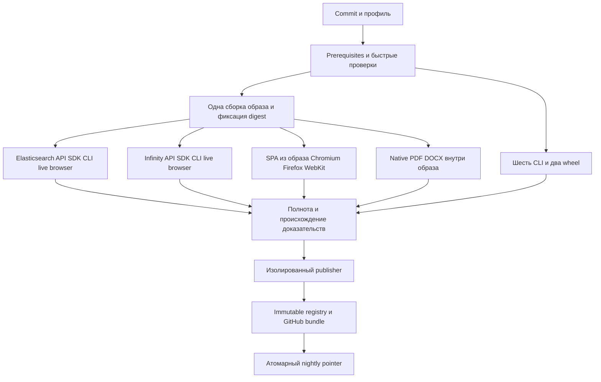

# Квалификация и выпуск RAGFlow

## Сценарий и границы

Каждый выпуск связывает исходный commit, образ, SPA, шесть CLI и два wheel с
исполняемыми проверками. Пользователь получает конкретный проверенный комплект.
Развёртывание runtime остаётся отдельной операцией со своим backup и health evidence.

Кодовая база изменений: `db81651c7898933e712f47890314523b8730b412`.
Незакоммиченные соседние изменения не становятся выпуском автоматически.
Успешные unit проверки подтверждают только их указанную границу.

## Владельцы

- `tests.yml`: единый исполнитель квалификации. `targeted` выбирает проверки по
  области изменений; `release` принудительно выполняет обе engine lane, API p3,
  browser matrix, native и комплектацию. Неверифицированный baseline выбирает полный набор.
- `release.yml`: события, квалификация и продвижение. Stable — только `vX.Y.Z`,
  совпадающий с версией проекта; nightly — main. Обновление тега `nightly` не запускает выпуск.
- `release_evidence.py`: политика достаточности доказательств.
- `release_origin.py`: GitHub origin, архивные digest и безопасное получение файлов.
- `release_publish.py`: перенос готового образа, immutable assets, журнал и указатели.
- `deployment/runner`: disposable stack, готовность, native probes и cleanup.

## Идентичность и доверие

`candidate-receipt.json` schema 2 неизменяем. Он содержит SHA, repository,
qualification run/attempt/profile, полный набор lane/results, digest staging и
целевого образа, закрытый список файлов с SHA256, SPA и browser inventory,
toolchain/native provenance и точные digest трёх обязательных Ollama моделей.
Статусы: `PASS`, `FAIL`, `CANCELLED`, `INCOMPLETE`. Только полный `PASS/release`
допускает публикацию. Селективный результат никогда не заменяет release.

Независимый `mandatory-api-cases.json` задаёт case inventory каждой suite/engine.
Missing, extra, duplicate, collection error, xfail и необоснованный skip блокируют
выпуск. `NOT_APPLICABLE` разрешён только для точного сценария с проверенным
engine/provider контрактом и причиной. Отсутствие инструмента, модели или второго
runtime не является неприменимостью. Browser inventory проверяется независимо
от JUnit на всех трёх браузерах.

Publisher получает архив по неизменяемому artifact ID. Проверяются API digest ZIP,
run/repository/head identities и происхождение в текущем attempt. Artifact API не
содержит attempt: он связывается именем и интервалом producer job. Затем сверяются
реальные результаты GitHub jobs и закрытый manifest извлечённых файлов.
Та же проверка применяется к каждому producer-артефакту до сборки общего пакета:
имя конкретного job, ID, digest, SHA и attempt сохраняются в `producer-origins.json`.
Publisher заново получает все producer-архивы, проверяет их origin и собирает
пакет доверенным кодом. Закрытый набор и байты файлов должны совпасть с полученным
qualification artifact. Inventories и установщики берутся из указанного source SHA;
содержимое общего collector-архива не становится источником политики.
Для каждого браузера сохраняются JSON и исходный JUnit XML. Publisher повторно
проверяет missing/extra/duplicate/skipped относительно source inventory и сверяет
результат с receipt. Одного заявления collector о прохождении браузеров недостаточно.
Готовые CLI имеют отдельные `cli-proofs` с результатами исполнения, toolchain и
хешем именно проверенного бинарника; при replay эти проверки исполняются снова.

Publisher выполняет только закреплённый доверенный commit `RELEASE_PUBLISHER_SHA`,
проверенный относительно защищённого main. Candidate code не выполняется с
credentials публикации. Stable tags должны создавать только уполномоченные
release actors из проверенного main; Environment сам по себе этого не обеспечивает.

`publication-receipt.json` — отдельное доказательство: qualification SHA256,
bundle ID, GitHub artifact origin, image digest и immutable release tag. Оно
публикуется вместе с manifest/checksums. Локальный deploy повторно проверяет digest
этих трёх assets через GitHub API доверенного форка. Самоподписанный JSON и его
собственный checksum не устанавливают доверие.

Schema 1 остаётся историческим доказательством. Автоматическая публикация её не
принимает; локальное восстановление требует явного `-AllowHistoricalReceipt` и
не означает прохождение современной квалификации.

### Первый выпуск

Разово разрешён bootstrap с утверждённым историческим QA-образом из
`tools/quality/release-bootstrap-baseline.json`. Его digest и source SHA фиксированы;
образ не объявляется ранее квалифицированным выпуском. GitHub ancestry и фактический
`SOURCE_REVISION` проверяются до disposable migration/backup/restore. Новый комплект
проходит всю обычную release-квалификацию. Upgrade proof имеет отдельный purpose
`initial-runtime-baseline-upgrade`, сохраняет `qualified=false` для исторической
точки и хеш утверждённой политики. Неуспех любой проверки блокирует выпуск.

`RELEASE_BOOTSTRAP_ENABLED=true` применим только при отсутствии предыдущего
квалифицированного тега. Publisher по живым GitHub Releases блокирует bootstrap,
если уже опубликован квалифицированный комплект. Разрешён только идемпотентный
повтор той же публикации с тем же тегом и qualification hash; новый выпуск этим
исключением воспользоваться не может. После первого выпуска выключить переменную
и задать `RAGFLOW_PREVIOUS_QUALIFIED_RELEASE`.

Receipt и release notes прямо указывают ограничение: восстановление первого
выпуска проверено до утверждённого исторического образа и backup snapshot;
доказательства полной квалификации этой исторической точки отсутствуют.

## Образы и комплект

Staging и готовый image tag включают SHA/run/attempt. Один SHA может иметь разные
build bytes; старый digest не перезаписывается. `bundle_id` описывает продуктовые
байты (image manifest, SPA, CLI/wheels/installers, toolchain и модели), независимо
от qualification/publication попыток. Перенос выполняется `skopeo --preserve-digests`;
после переноса хешируются исходные bytes manifest. Проверка относится к полному
manifest/index digest и архитектуре Linux, использованной в live lane.

Engine контейнеры используют entrypoint и код итогового образа. Native probe
отдельно исполняет бинарник CLI этого образа и parser test binary из репозиторного
build wrapper. В отчёте instrumentation отмечена отдельно. Native PDF extraction
и rendering с mock layout не доказывают работу реальной OCR/layout модели.

Комплект содержит шесть portable CLI без CGO, wheels `ragflow-sdk`/`ragflow-cli`,
установщики, qualification archive, receipt, publication proof, manifest и SHA256SUMS.
Установщики вызываются с `GITHUB_REPO=meownm/ragflow` / `-GitHubRepo meownm/ragflow`.
`latest` означает stable; nightly не меняет stable latest. Внутренний Docker image
потребляется по digest, без неоднозначного mutable Docker latest.

## Повторная квалификация

Первый `release` запускается с `dry_run=true`. Для второго полного прогона того же
SHA задаются `replay_artifact_id`, `replay_run_id`, `replay_attempt` первого полного
qualification artifact. Origin и весь packet проверяются; CLI/wheels переиспользуются,
image загружается по прежнему digest. Проверки исполняются заново с отдельными
disposable ресурсами. Новый receipt обязан сохранить `bundle_id`.

Это воспроизводимость квалификации готового комплекта. Побайтовая воспроизводимость
независимой повторной сборки является отдельным свойством и этим тестом не заявляется.
Повтор publisher использует первоначальный qualification artifact, не смешивает
его с результатами другой попытки и не пересобирает продукт.

## Публикация и восстановление после обрыва

Сериализуется только publisher: `queue: max`, `cancel-in-progress: false`.
Перед внешними изменениями записываются и повторно читаются append-only assets
`journal-NNNNNN.json` draft release `publication-<release-tag>`. Журнал не содержит
credentials и переживает потерю процесса или VM. Неполная попытка получает
`INCOMPLETE`; повтор сверяет фактическое состояние registry, assets и канала.

Immutable образ и GitHub assets сначала проверяются целиком. Существующий stable
tag с другим содержимым отклоняется. Уже загруженные assets проверяются по digest,
не заменяются `--clobber`. Только после readback bundle становится видимым.

Nightly использует единственный авторитетный указатель: Git ref `tags/nightly`
на annotated tag, JSON message которого указывает immutable bundle, digest и
qualification hash. Старый ref и новый tag object записываются в журнал до PATCH.
Один атомарный ref update оставляет доступным предыдущий или целиком проверенный
новый комплект. После потери ответа retry распознаёт уже обновлённый ref. Более
старый qualification run не перезаписывает более новый nightly.

GitHub и registry не образуют общей транзакции: immutable orphan image/draft может
остаться после отказа. Он не считается выпуском и не делает старый канал недоступным.
Journal retention и orphan cleanup выполняет администратор после reconciliation,
с сохранением опубликованных bundle и rollback window; CI не удаляет чужие ресурсы.

## Изоляция, очередь и диагностика

См. [изоляцию runner](ci-runner-isolation-ru.md) и [runner tooling](../../deployment/runner/README.md).
Test и publisher — разные VM; hypervisor, Nexus и его БД находятся вне CI accounts.
Существующий test runner с host root сначала выводится с host, credentials ротируются.
Publisher имеет staging read и release write; consumer — release read.

Hosted precheck проверяет online runner до тяжёлых jobs. Watchdog запускается раз
в десять минут и отменяет запуск с инфраструктурной причиной после offline >15min
или занятой очереди тестового runner >2h. Очередь публикации исключена: GitHub API
не различает ожидание Environment, concurrency и назначения runner; её готовность
проверяется до квалификации. Порог 15min при этой частоте означает фактическое обнаружение
в интервале 15–25min плюс задержка scheduler. Ожидание Environment approval и
publication concurrency диагностируется отдельно от ожидания self-hosted runner.

Логи проходят redaction до CI output. Диагностические XML payloads и logs очищаются
перед хешированием публичного qualification packet. Не публиковать реальные tenant
данные; fixtures должны быть синтетическими и disposable. Полнота тестов, качество
продукта, publication и runtime deployment имеют отдельные результаты.

## Включение процесса

1. Завершить VM isolation, staging/release ACL, CA, tokens, Environment и tag rules.
2. Восстановить падающие контракты; сохранить branch coverage Business Documents ≥79%.
3. Провести два полных dry qualification одного комплекта через replay.
4. Проверить registry refusal, partial upload, process loss, tampering, wrong source/
   attempt, missing runner/model/case, повтор publisher и конкурирующие nightly.
5. Проверить migration/restore на disposable копии предыдущего квалифицированного
   runtime. Первый выпуск использует только утверждённый разовый bootstrap выше;
   отсутствие его проверок не превращается в rollback PASS. Image rollback без восстановления DB не доказывает
   data rollback. Зафиксировать RPO backup и ограничения обратной совместимости.
6. Выпустить внутренний nightly вручную; только после приёмки установить
   `RELEASE_NIGHTLY_ENABLED=true`. После пяти содержательных запусков обновить required
   checks и удалить временный вход `sep-tests.yml`.

Текущая реализация не означает выполненную live приёмку. Подготовленные VM/bootstrap
и проверки политики требуют исполнения в целевой инфраструктуре; результаты и
оставшиеся блокеры фиксируются в отчёте конкретного внедрения.
