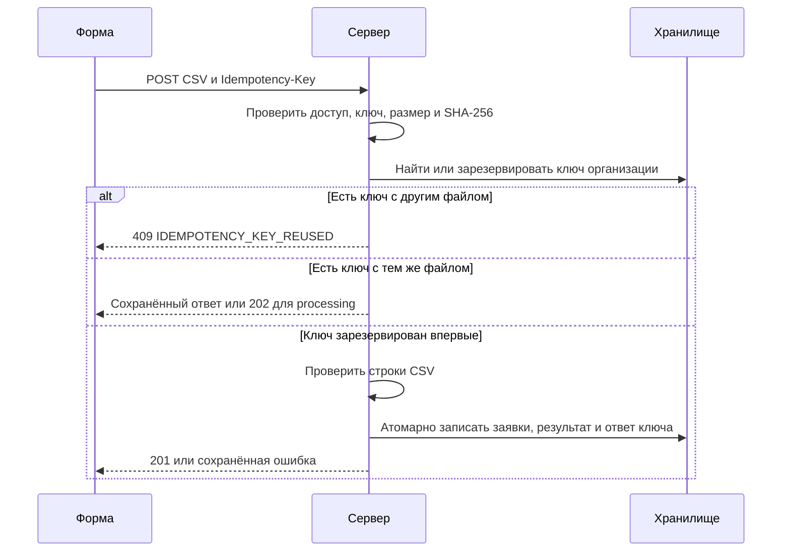
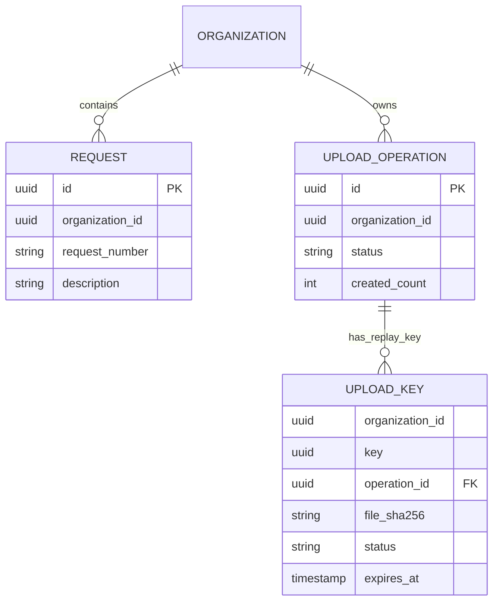

## 1. Назначение и цель

Реализовать загрузку заявок из CSV для текущей организации с атомарной записью файла. Назначение соответствует BR-01. Основание: «БТ загрузки заявок CSV — учебное демо», BR-01–BR-07; конкретная согласованная редакция выбирается при проверке соответствия.

## 2. Общие сведения, термины, сокращения и ссылки

CSV — текст UTF-8 с разделителем `;`. Заголовок: `request_number;description`. Оба поля непустые. `request_number` — строка до 40 символов, `description` — строка до 200 символов. Один файл содержит от 1 до 100 строк данных. Это технические границы учебного формата.

Организация определяется сервером по авторизованному пользователю; клиент не передаёт `organization_id`. 1 МБ = 1 000 000 байт. UUID — идентификатор операции. Ключ повтора — идентификатор одной логической загрузки; один ключ сохраняется на время обработки и на 24 часа после завершения операции.

Примеры endpoint-ов описывают проектируемую функцию загрузки, а не существующее API редактора ТЗ. Статусы операции: `processing`, `completed` и `failed`.

## 3. Компоненты подлежащие доработки с описанием изменений

| Компонент | Доработка |
| --- | --- |
| Форма загрузки | Выбор CSV, отправка, состояние ожидания, вывод результата или ошибки |
| Сервер загрузки | Проверка роли и организации, проверка CSV, атомарная запись заявок |
| Хранилище | Заявки организации и результаты операций |
| Журнал | Безопасные метаданные операции без содержимого файла |

## 4. Конфигурирование (настройки)

### 4.1. Конфигурации сервисов (дополнительные)

`CSV_MAX_BYTES = 50000000` (50 МБ). `CSV_MAX_ROWS = 100`. `CSV_ENCODING = UTF-8`. `CSV_DELIMITER = ;`.

`IDEMPOTENCY_TTL_SECONDS = 86400`. Срок отсчитывается от `completed_at`; пока операция выполняется, ключ не истекает.

`UPLOAD_BUSY_INDICATOR = true`. Во время загрузки показывать индикатор занятости.

`LOG_INCLUDE_DURATION_MS = true`. При завершении добавлять в журнал duration_ms — длительность операции в миллисекундах.

### 4.2. Права, ограничения и управление правами

Роли учебной функции: `operator` загружает и читает результаты своей организации; `reader` только читает результаты своей организации. Другой организации данные недоступны. Сервер повторяет проверку роли и организации на каждом запросе. При отсутствии сессии — HTTP 401, при запрете загрузки — HTTP 403. Идентификатор чужого результата возвращает HTTP 404 без раскрытия данных.

## 5. Прототипы интерфейсов и сценарии использования

### Экран загрузки

Поля: выбор файла CSV; пояснение «Выберите файл CSV с заявками.»; кнопка «Загрузить CSV»; область результата `operation_id`, `created_count`. Содержимое строк не показывается. Во время отправки кнопка недоступна. При ошибке показывается сообщение сервера, файл остаётся выбранным; оператор может повторить отправку после устранения ошибки.

| ID | Участник и предусловия | Шаги и реакция |
| --- | --- | --- |
| UC-01 | Оператор своей организации, корректный CSV | Выбрать файл → нажать кнопку → дождаться результата с ID операции и числом заявок |
| UC-02 | Оператор, файл больше 50 МБ или неверный CSV | Отправить файл → увидеть причину отказа → заявки не созданы |
| UC-03 | Читатель или другой пользователь | Загрузка запрещена; результаты доступны только в своей организации |
| UC-04 | Пользователь своей организации | Перезагрузить экран → открыть ранее полученный `operation_id` → увидеть сохранённый результат |

### Повтор загрузки

Выбор другого файла начинает новую операцию с новым ключом; явный повтор после потери ответа сохраняет прежний ключ.

| ID | Участник и предусловия | Шаги и реакция |
| --- | --- | --- |
| UC-05 | Оператор потерял ответ | Повторить тот же файл с тем же Idempotency-Key → получить прежний результат без новых заявок; новый ключ при таком повторе не создавать |
| UC-06 | Оператор повторяет ключ с другим файлом | Получить HTTP 409 IDEMPOTENCY_KEY_REUSED, без записи |
| UC-07 | Исходная операция ещё выполняется | Повтор возвращает HTTP 202 со ссылкой на результат; повторная обработка не запускается |

## 6. Логика работы

Сервер сначала проверяет роль и организацию, наличие и формат Idempotency-Key и размер файла. Вычисляет SHA-256 исходных байтов файла. Перед проверкой дублей номеров ищет ключ в области организации: в течение обработки и 86400 секунд после completed_at тот же ключ с тем же SHA-256 возвращает сохранённый ответ, а с другим SHA-256 — HTTP 409 IDEMPOTENCY_KEY_REUSED. Для processing возвращается HTTP 202 с Location на результат. Повтор завершённой ошибки возвращает прежние HTTP и тело ошибки. Истёкший завершённый ключ можно занять заново; уникальность номеров заявок по-прежнему действует.

Новая UploadOperation создаётся со статусом processing и created_count=0; связанный ключ атомарно резервируется в UploadKey со статусом processing. Параллельный запрос с тем же ключом не запускает вторую обработку. Все строки CSV валидируются до записи. Повтор номера в файле или в организации отклоняет файл. В одной транзакции создаются все заявки, результат completed и сохранённый ответ ключа. Ошибка откатывает все заявки; отдельно сохраняются failed и ответ ошибки. completed_at устанавливается при завершении, expires_at = completed_at + 86400 секунд. Клиент получает только метаданные результата. Операции и ключи всегда ограничены организацией сессии.



## 7. Модель данных

| Сущность | Поля и ограничения |
| --- | --- |
| Request | `id: UUID PK`, `organization_id: UUID NOT NULL`, `request_number: string(40) NOT NULL`, `description: string(200) NOT NULL`; UNIQUE(`organization_id`, `request_number`) |
| UploadOperation | `id: UUID PK`, `organization_id: UUID NOT NULL`, `actor_id: UUID NOT NULL`, `status: processing/completed/failed NOT NULL`, `created_count: integer NOT NULL`, `error_code: string/null`, `completed_at: UTC timestamp/null`; `created_count=0` при ошибке |



Чтение заявок и операций всегда ограничено организацией сессии. Удаление результатов и срок их хранения не определены. Это отдельно от срока ключа повтора; истечение ключа не удаляет результат операции.

| Сущность | Поля и ограничения |
| --- | --- |
| UploadKey | `organization_id: UUID NOT NULL`, `key: UUID NOT NULL`, `file_sha256: hex64 NOT NULL`, `operation_id: UUID FK NOT NULL`, `status: processing/completed/failed NOT NULL`, `response_http: integer/null`, `response_body: JSON/null`, `completed_at: UTC timestamp/null`, `expires_at: UTC timestamp/null`; UNIQUE(`organization_id`, `key`); expires_at отсутствует до завершения |

UploadKey ссылается на одну UploadOperation; ответ хранится для точного повтора. Просроченная запись ключа заменяется только при атомарном резервировании новой операции.

## 8. Сигнатура взаимодействия

### Загрузка

`POST /demo/v1/request-uploads`. Авторизованная сессия, `multipart/form-data`, обязательное поле `file`, обязательный заголовок `Idempotency-Key` (UUID). Допускается размер файла до 50 МБ включительно. `organization_id` из тела не принимается. Размер относится к байтам файла, а не ко всему multipart-конверту.

Пример файла:

```csv
request_number;description
DEMO-001;Проверить учебную заявку
DEMO-002;Подготовить учебный отчёт
```

HTTP 201, пример результата:

```json
{"operation_id":"11111111-1111-4111-8111-111111111111","created_count":2}
```

### Чтение результата

`GET /demo/v1/request-uploads/{operation_id}`. HTTP 200 возвращает `operation_id`, `created_count`; неуспешная операция возвращает HTTP 422 с `code`, `message`. Проверяется организация сессии; неизвестная или чужая операция — HTTP 404. Читатель может выполнять этот запрос для своей организации.

| HTTP | code | message |
| --- | --- | --- |
| 401 | UNAUTHENTICATED | Требуется вход. |
| 403 | UPLOAD_FORBIDDEN | Загрузка недоступна для вашей роли. |
| 404 | RESULT_NOT_FOUND | Результат не найден. |
| 413 | LIMIT_EXCEEDED | Файл превышает допустимый размер. |
| 422 | INVALID_CSV | Проверьте формат CSV. |
| 422 | DUPLICATE_REQUEST_NUMBER | Номер заявки уже используется. |

Ошибка содержит только `code` и `message`, без содержимого CSV. Пример:

```json
{"code":"LIMIT_EXCEEDED","message":"Файл превышает допустимый размер."}
```

### Повтор запроса

Клиент генерирует Idempotency-Key до первой отправки и сохраняет его вместе с выбранным файлом. При потере ответа повторяет тот же ключ и файл. Пример заголовка: `Idempotency-Key: 22222222-2222-4222-8222-222222222222`. В течение обработки и 24 часов после завершения тот же ключ и файл возвращают прежние HTTP и тело (для примера успеха — HTTP 201 с тем же operation_id и created_count=2). Тот же ключ с другим SHA-256 файла даёт HTTP 409 с `code=IDEMPOTENCY_KEY_REUSED`, `message=Ключ уже использован для другого файла.`. Выполняющаяся операция даёт HTTP 202 с `Location: /demo/v1/request-uploads/{operation_id}` и телом `{"operation_id":"11111111-1111-4111-8111-111111111111","status":"processing"}`. GET выполняющейся операции также возвращает HTTP 202. Отсутствующий или неверный ключ — HTTP 400 с `code=INVALID_IDEMPOTENCY_KEY`, `message=Укажите ключ повтора в формате UUID.`. По истечении 24 часов завершённый ключ допускает новую операцию; проверки дублей номеров продолжают действовать.

## 9. Журналирование

Для завершения операции записывать `time_utc`, `organization_id`, `actor_id`, `operation_id`, `status`, `error_code`. Для отказов до создания операции `operation_id=null`. При отсутствии авторизованной сессии `organization_id` и `actor_id` равны null. CSV, строки, тела запросов и ответов, токены и заголовки авторизации не журналировать.

Ключ повтора и file_sha256 не журналировать. Повтор отмечать событием `upload_replay` с operation_id исходной операции; событие новой завершённой загрузки при повторе не создавать.

При завершении операции добавлять duration_ms — целое неотрицательное число миллисекунд.
