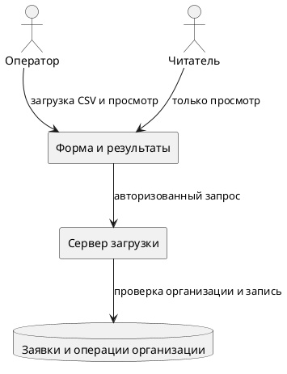
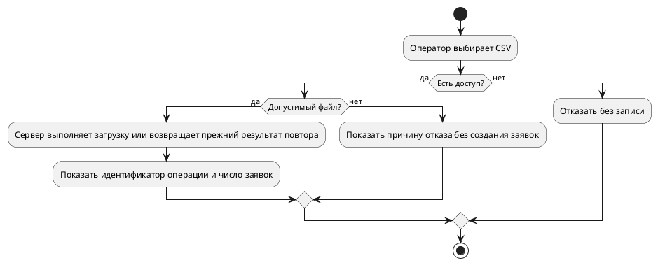

## 1. Цель

Обеспечить загрузку заявок из CSV в пределах текущей организации. Этот документ описывает учебную функцию; персональные данные в примере отсутствуют.

BR-01. Оператор загружает один CSV с заявками и получает число созданных заявок и идентификатор операции. Корректный CSV обрабатывается целиком; при ошибке файла не создаётся ни одной заявки.

## 2. Нормативно-правовые акты (НПА)

Требования не определены.

## 3. Целевая аудитория

Сотрудники, загружающие заявки и просматривающие результаты загрузки в своей организации.

### 3.1. Пользователи и их категории

BR-02. Оператор загружает CSV и просматривает результаты своей организации. Читатель просматривает результаты своей организации, но не загружает CSV. Пользователь другой организации не получает ни результаты, ни заявки текущей организации. Ограничения проверяются сервером.

### 3.2. Географический охват

Требования не определены.

### 3.3. Потребность целевой аудитории

BR-03. Повтор отправки после потери ответа не должен создавать повторные заявки. В течение 24 часов после завершения операции повтор с тем же ключом и тем же файлом возвращает прежний результат; тот же ключ с другим файлом даёт конфликт. После истечения 24 часов ключ можно использовать для новой операции. Ключ действует только внутри одной организации.

## 4. Концепция (общая схема) взаимодействия с детализацией данных

Форма загрузки передаёт CSV серверу. Сервер проверяет доступ и файл, сохраняет результат операции и показывает его пользователю.

### 4.1. Концептуальная схема взаимодействия

### 4.2. Контрагенты

Требования не определены.

### 4.3. Клиентские сценарии (схемы) с сопровождающим текстом

BR-04. Принимается CSV в UTF-8 с разделителем `;` и заголовком `request_number;description`; оба поля обязательны, `request_number` уникален внутри файла и среди заявок организации. Допускается от 1 до 100 строк данных, request_number не длиннее 40 символов, description не длиннее 200 символов. Размер файла не более 20 МБ, где 1 МБ = 1 000 000 байт. Превышение размера, неверный формат или дубли номеров отклоняются без частичной загрузки.

BR-05. Пользователь получает понятную причину отказа: нет доступа, файл больше допустимого, неверный формат, дубли номеров или конфликт ключа. Во время загрузки повторное нажатие кнопки недоступно; после потери ответа доступен явный повтор исходной операции. Повтор уже выполняющейся операции не запускает вторую обработку.

## 5. Нефункциональные требования

Параметры производительности и доступности не определены.

### 5.2. Прототип

Экран содержит выбор CSV, пояснение, кнопку загрузки и область результата с идентификатором операции и числом созданных заявок. Подпись кнопки может быть уточнена в ТЗ. Поля заявок в результат не выводятся.

### 5.3. Требования к дизайну

Требования не определены.

### 5.4. Требования к отчетности

BR-06. Завершённый успешный результат загрузки содержит только `operation_id` и `created_count`; чтение результата ограничено организацией пользователя. Результаты доступны после перезагрузки экрана. Ответ об операции, которая ещё выполняется, может дополнительно содержать статус обработки без данных заявок.

### 5.5. Мониторинг

BR-07. Журнал операции содержит время UTC, организацию, пользователя, идентификатор операции, статус и код ошибки. CSV, его строки, тела запросов и ответов, токены и заголовки авторизации в журнал не записываются.
