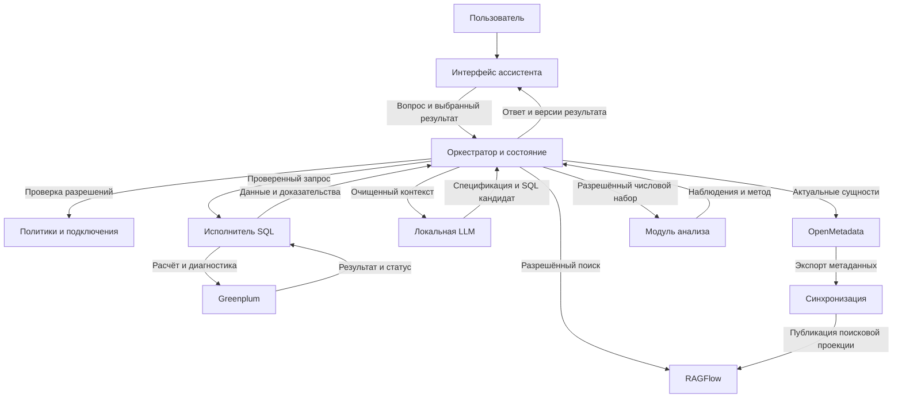
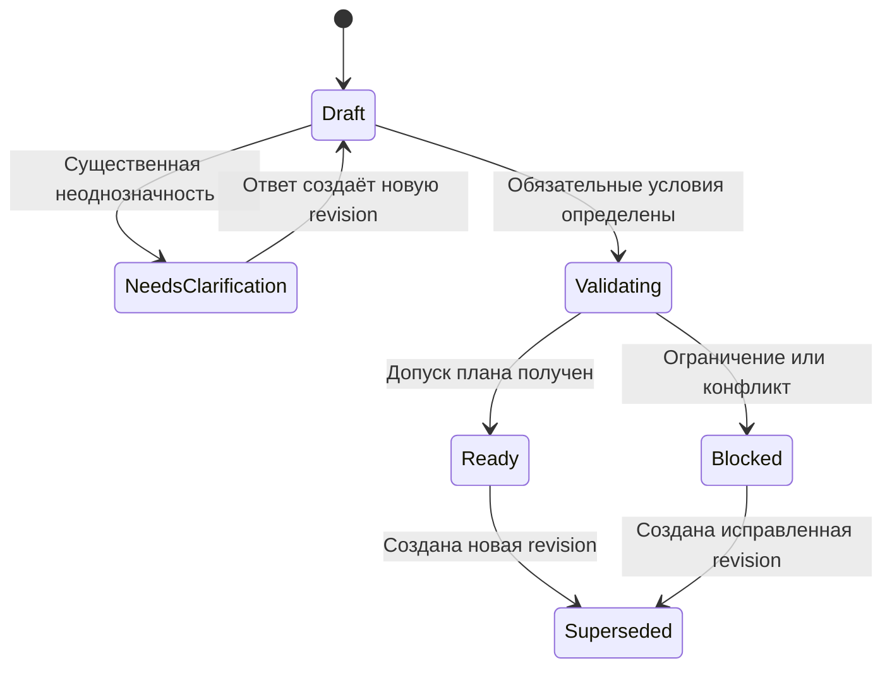
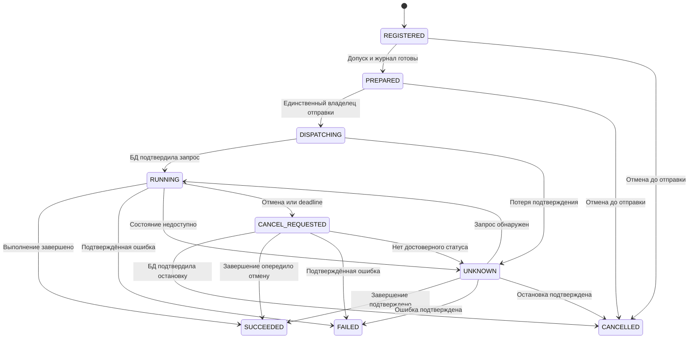

# Бизнес требования и алгоритмы SQL ассистента

> Снимок требований v0.5 от 2026-10-28. Источник: https://chatgpt.com/space/page_56f1b58c00048191a00e59171e11b763

Требования к SQL-ассистенту «Контекст» описывают пользовательские результаты, правила расчёта и взаимодействия с OpenMetadata, RAGFlow, Greenplum и локальной LLM. Документ предназначен для согласования владельцем продукта, аналитиком, владельцем данных и командой разработки.

**Предлагаемая модель:** четыре пользовательских сценария в одной исследовательской сессии. Четыре сценария: вопрос к данным, исследование каталога, drill-down и исследование отклонений. Уточнение и простое сравнение периодов входят в диалог. Общая основа — неизменяемые версии QuerySpec и QueryPlan, разрешённый контекст и контролируемое исполнение SQL. OpenMetadata остаётся источником каталоговых описаний; RAGFlow используется как поисковая проекция; Greenplum — источник фактических данных.

**Статус:** проект требований v0.5 от 28 октября 2026 года. Этапность E0–E6 разделяет технический запуск, ограниченный пилот, полный P0 и расширения P1. Требования и AC-01–49 сохранены; контрольные точки связаны с DoR/DoD. Календарный план уточняется после проверки контура и мощности команды.

[Макеты в Figma](https://www.figma.com/design/uMawlYp77varvtoj9OUJfa) · [Кликабельный маршрут](https://www.figma.com/proto/uMawlYp77varvtoj9OUJfa?node-id=8-2&starting-point-node-id=8%3A2)

# Исходный контур и границы

| Подтверждено в обсуждениях | Следствие для решения |
| --- | --- |
| Заполненный OpenMetadata и подключения к БД | Переиспользовать каталог и подключения; не создавать второй независимый каталог |
| КХД на Greenplum | Зафиксировать версию и проверить диалект, драйвер, планировщик и способы ограничения запросов на этой версии |
| Метаданные OpenMetadata уже загружены в RAGFlow | Считать содержимое RAGFlow индексированным снимком, который может отставать от источника |
| Локальная LLM и ориентация на открытые решения | Выполнять генерацию, embeddings и reranking в разрешённом контуре; конкретные модель и релиз вынести в конфигурацию |
| Восемь экранов Figma | Сохранить связь требований с экранами и переходами; демонстрационные параметры не считать утверждёнными промышленными настройками |

В макете целевой источник обозначен Greenplum. Демонстрационные данные не получены из подключённой БД; версии Greenplum, OpenMetadata, RAGFlow и возможности адаптеров фиксируются перед разработкой.

В первый контур входят поиск и чтение метаданных, вопросы к разрешённым витринам, управляемое уточнение, выполнение SELECT в согласованной области, работа с версиями результатов, drill-down и простое сравнение периодов. Далее добавляются многошаговое исследование отклонений и предложения по улучшению метаданных. Изменение бизнес-данных, автоматическое изменение схем БД, автономная публикация определений метрик, межбазовые JOIN и постоянный мониторинг по расписанию требуют отдельных постановок.

Существующими не считаются: синхронизация по событиям, отдельный реестр семантики, хранилище состояния ассистента, делегирование прав пользователя, SQL executor, интеграция с IdP и механизм публикации исправлений в OpenMetadata. Ниже описаны целевые обязанности этих механизмов; их размещение может быть модульным в существующем приложении без выделения новых микросервисов.

# Цели и бизнес требования

Цель — сократить путь от бизнес-вопроса до проверяемого результата, сохраняя смысл показателей, права пользователя и возможность воспроизвести ход расчёта. Успех измеряется качеством результата и временем выполнения задачи, а не количеством сгенерированных SQL-запросов.

| ID | Требование и ожидаемый результат | Приоритет | Проверка |
| --- | --- | --- | --- |
| BR-01 | Пользователь задаёт вопрос на русском языке и получает таблицу, подходящую визуализацию и краткий ответ с периодом и единицами измерения | P0 | AC-01 |
| BR-02 | При неоднозначности пользователь последовательно выбирает сущность, определение метрики, связь или фильтр; подтверждённые условия сохраняются | P0 | AC-02 |
| BR-03 | Пользователь находит таблицы и поля, понимает зерно данных, определения, владельца, качество и происхождение связей | P0 | AC-03 |
| BR-04 | Пользователь детализирует строку или точку результата, видит унаследованные условия и получает новый результат с возможностью возврата | P0 | AC-04 |
| BR-05 | Пользователь исследует отклонения и ряды по понятному плану; наблюдения, гипотезы и ограничения различаются | P1 | AC-05 |
| BR-06 | Для каждого ответа доступны спецификация, SQL, источники, время расчёта, выполненные проверки и границы полноты | P0 | AC-06 |
| BR-07 | Пользователь получает только разрешённые ему метаданные и данные, включая историю, кэш, экспорт и диагностические сообщения | P0 | AC-07 |
| BR-08 | Ошибки, отсутствие доступа, отсутствие строк, тайм-аут и неполный результат имеют разные состояния и дальнейшие действия | P0 | AC-08 |
| BR-09 | Пользователь видит актуальность определения и полноту исходных данных за период; неизвестная свежесть не выдаётся за подтверждённую | P0 | AC-09, AC-17 |
| BR-10 | Пользователь может остановить расчёт, а владелец платформы — ограничить его стоимость и нагрузку на КХД | P0 | AC-10 |
| BR-11 | Полезный запрос можно повторить как новую попытку, сохранив исходный ответ и историю изменений | P0 | AC-06 |
| BR-12 | Пользователь может сообщить об ошибке и предложить уточнение описания; долговременное знание изменяется через владельца данных | P1 | AC-11 |
| BR-13 | Пользователь различает расчёт по согласованному определению и исследовательский расчёт; уровень проверки не скрывается за общей отметкой «проверено» | P0 | AC-13 |
| BR-14 | Пользователь сравнивает два заданных периода по одной версии метрики и видит абсолютное и допустимое относительное изменение | P0 | AC-19 |
| BR-15 | Новый вопрос, поздний ответ и возврат к прежнему результату не подменяют выбранные условия и текущую ветку диалога | P0 | AC-14 |

Для пилота отдельно измеряются: корректность выданных ответов = правильные ответы / все выданные ответы; покрытие = задачи, завершённые правильным ответом / все допустимые задачи; доля неверных ответов, показанных без нужного ограничения; успешность уточнений; время до корректного результата; нагрузка на КХД. Корректные отказы, запросы уточнений и ошибки учитываются раздельно. Для retrieval измеряются полнота обнаружения нужных сущностей и доля задач с полным допустимым путём соединения. Снижение времени на 30% и корректность не ниже 90% для однозначных задач остаются кандидатами, а не утверждёнными порогами. До пилота фиксируются выборка, знаменатели, допустимые ошибки и критерии допуска; рост отказов не должен маскировать снижение покрытия.

# Роли и ответственность

| Роль | Полномочия в ассистенте | Граница |
| --- | --- | --- |
| Бизнес-пользователь | Вопросы, уточнения, просмотр результата, разрешённый drill-down, остановка своей задачи | Не изменяет глобальные метрики и права |
| Аналитик | Дополнительно просмотр и разрешённое редактирование SQL, диагностика расчёта, работа в исследовательском режиме | Ручной SQL проходит тот же контроль доступа и исполнения; прежнее подтверждение бизнес-смысла после правки не наследуется |
| Владелец данных или steward | Согласование определений, допустимых JOIN, качества и предложений по метаданным | Согласование не выдаёт доступ к данным автоматически |
| Администратор подключения и DBA | Регистрация подключения, роли БД, список витрин, лимиты, отмена задач, эксплуатационные настройки | Секреты не передаются пользователю или LLM |
| Владелец продукта | Приоритеты, состав пилота, допустимые сценарии, критерии приёмки | Не подменяет владельца определения бизнес-метрики |

Права на каталог и права на данные проверяются независимо. Доступ к карточке таблицы в OpenMetadata не означает разрешения читать её строки в Greenplum. Конкретный IdP и способ сопоставления групп с ролями подключаются через адаптер после инвентаризации текущего контура.

# Состав решения и источники истины

| Система или логический модуль | Состояние | Ответственность и данные |
| --- | --- | --- |
| OpenMetadata | Существует | Описания активов, терминов, владельцев, связей и качества; идентичность сущности и версия описания |
| RAGFlow | Существует | Поиск релевантных фрагментов индексированного снимка; ссылки на исходную сущность и версию |
| Greenplum | Существует | Бизнес-данные, фактическая физическая схема и исполняемые права БД; расчёты по исходным данным |
| Локальная LLM | Существует как выбранный подход | Интерпретация вопроса, варианты спецификации, SQL-кандидат и объяснение; не источник фактических значений и прав |
| Интерфейс ассистента | Целевая реализация прототипа | Диалог, спецификация, результат, выбранный контекст, прогресс и ошибки |
| Оркестратор и состояние сессии | Новый или дорабатываемый модуль | Переходы диалога, QuerySpec и QueryPlan, журнал команд/запусков, бюджеты, результаты и доказательства |
| Адаптер каталога и синхронизация | Доработка существующей загрузки | Нормализация метаданных, разрешённый граф связей, актуализация по UUID, версии документов и атомарная публикация манифеста индекса |
| Политики доступа и реестр подключений | Интеграция с текущими средствами | AccessContext: разрешённые активы/поля/операции, ограничения строк и DB-role; конфигурация подключения и ссылка на секрет |
| Исполнитель SQL | Новый или дорабатываемый модуль | Проверка SQL, preflight, подключение к Greenplum, лимиты, запуск, отмена, получение и классификация результата |
| Модуль числового анализа | Расширение P1 | Детерминированные методы рядов и декомпозиции. Простое сравнение периодов P0 выполняется обычным расчётным слоем без этого расширения |

Утверждённое определение метрики должно иметь одного владельца и одну идентифицируемую версию. Сначала используется подходящий объект или расширение существующего каталога. Если текущая модель OpenMetadata не выражает необходимую формулу и правила агрегации, допускается минимальный версионируемый реестр семантики со ссылками на OMD. Он не создаётся заранее как второй каталог. Для пилотного домена владелец утверждает перечень поддерживаемых метрик и разрезов, зерно, формулы, временную семантику, допустимые пути JOIN, правила полноты источников и эталонные вопросы. Заполненные описания таблиц сами по себе не являются критерием готовности домена.

Схема показывает логические вызовы и потоки. Пользовательские задачи запускаются асинхронно; чтение контекста и отдельный запрос к модели являются шагами задачи. Синхронизация каталога выполняется отдельно от пользовательской сессии. Размещение этих модулей в RAGFlow, существующем backend или отдельном приложении выбирается после проверки текущей реализации SQL-конструктора.

## Режимы расчёта

| Режим | Допустимая основа | Представление результата |
| --- | --- | --- |
| По согласованным определениям | Версионируемые метрики и разрезы; утверждённые связи; поддерживаемая грамматика QuerySpec | DEFINITION_VALIDATED: выполнены перечисленные проверки соответствия определению; актуальность и полнота показываются отдельно |
| Исследование аналитика | Новые выражения, гипотезы и разрешённый ручной SQL; явный выбор уполномоченного аналитика | EXPLORATORY: показаны проверки и неподтверждённые допущения; результат не становится утверждённой метрикой |

В P0 согласованный режим поддерживает выбор разрешённых полей, типизированные фильтры, группировки, согласованные JOIN и агрегации из реестра возможностей: суммы, количества, min/max, distinct count, средние и отношения с явно заданными правилами. Для каждого оператора фиксируются входное зерно, правила NULL, единицы и допустимость повторной агрегации. Расчёты вне поддерживаемой грамматики переводятся в явно выбранный исследовательский режим либо отклоняются с причиной. Уточнение пользователя не утверждает глобальную формулу и не расширяет права.

Для согласованного режима SQL строится детерминированным компилятором поддерживаемой QuerySpec или проверенным шаблоном. LLM предлагает структурированное намерение и объяснение. Свободная генерация SQL используется в исследовательском режиме; оценка другой LLM не заменяет проверку семантики. Ручное изменение SQL создаёт новый кандидат и снимает прежний статус DEFINITION_VALIDATED; восстановить его можно только через поддерживаемую QuerySpec и повторную компиляцию/проверку.

# Функциональные правила

| ID | Обязательное поведение |
| --- | --- |
| SR-01 | Команда содержит client_request_id и ожидаемую revision сессии; план/запуск привязаны к spec_id и revision. «Этот результат» разрешается через result_id; поздний ответ не меняет активную ветку |
| SR-02 | AccessContext ограничивает retrieval и очистку сущностей, полей и описаний до LLM/выдачи; пустая разрешённая область не превращается в поиск по всем документам. Текст метаданных не является командой |
| SR-03 | Объект из RAGFlow проверяется по UUID и актуальной версии OpenMetadata; актуальность физической схемы и исполняемые права проверяются средствами подключения |
| SR-04 | Система различает бизнес-метрику, физическое поле и алиас. Нельзя выбирать одноимённое поле только по сходству текста |
| SR-05 | Спецификация фиксирует формулу, зерно, время, валюту, NULL, фильтры, JOIN, агрегации и источник каждого решения |
| SR-06 | Блокирующее уточнение требуется при нескольких материально разных трактовках. Явно заданные условия и утверждённые значения по умолчанию не спрашиваются повторно |
| SR-07 | JOIN обосновывается ключами, кардинальностью, типом и бизнес-смыслом. Lineage и совпадение названий колонок не доказывают допустимость JOIN |
| SR-08 | Для отношения 1:N или N:M проверяется риск размножения фактов. DISTINCT не используется как универсальное исправление суммы |
| SR-09 | Каждый SQL, включая диагностический и ручной, проходит одинаковые проверки доступа, структуры, функций и лимитов. Подтверждение соответствия определению выдаётся только для поддерживаемого согласованного режима |
| SR-10 | Только SELECT недостаточно для безопасности: проверяются вложенные CTE, SELECT INTO, вызываемые функции, внешние источники и обращения к запрещённым объектам |
| SR-11 | LIMIT отображения ограничивает выдачу строк, но не стоимость сканирования и не исходную совокупность для расчёта метрики |
| SR-12 | Числа в ответе формируются из результата SQL или детерминированного расчёта; LLM объясняет их, но не заменяет вычисление |
| SR-13 | Изменение смысла запроса создаёт новую QuerySpec; повтор того же расчёта создаёт новый run_id. История не перезаписывается |
| SR-14 | Result раздельно хранит execution_status, output_completeness, source_completeness и definition_status; неизвестная полнота источника не равна complete |
| SR-15 | Новый drill-down сохраняет условия родителя и фиксирует добавленные условия. Агрегация пересчитывается по исходным данным, если текущий набор неполон или имеет иное зерно |
| SR-16 | Ошибка доступа не интерпретируется как отсутствие строк. Нулевой результат не запускает автоматическое расширение фильтров |
| SR-17 | Отмена подтверждается после получения конечного состояния исполнителя. Потеря HTTP-соединения не означает остановку SQL |
| SR-18 | Исправление SQL ограничено бюджетом и создаёт новый QueryPlan. Изменение смысла создаёт новую QuerySpec; ручная правка не наследует прежний статус проверки |
| SR-19 | Доступ повторно проверяется при открытии истории, получении страницы данных, экспорте и повторном запуске; права не фиксируются навсегда в сессии |
| SR-20 | Изменение каталога отделено от уточнения текущего расчёта и от обычной обратной связи |
| SR-21 | QueryPlan неизменяем и связывает SQL/параметры, версию спецификации, зависимости, AccessContext и checks. Изменение любого из них требует нового плана и допуска |
| SR-22 | Один client_request_id в области пользователя/сессии соответствует одной входящей команде; другое содержимое даёт конфликт. Автоматические SQL-шаги имеют устойчивые execution_command_id; UNKNOWN не запускает resend |
| SR-23 | Активные документы RAG не изменяются по месту; retrieval использует зафиксированный манифест поколения и актуальные разрешения |
| SR-24 | Между найденными сущностями строится полный разрешённый путь JOIN, включая промежуточные таблицы; неоднозначный путь уточняется по бизнес-смыслу |
| SR-25 | Перед обычным ответом и сравнением проверяется политика полноты источников; ожидание пользователя не расходует бюджет активной обработки |
| SR-26 | Смена модели, промпта, компилятора, retrieval или семантических определений требует регрессионной проверки затронутого домена |

# Модель состояния исследования

История сообщений служит пояснением. Диалог, версии спецификации, планы и попытки исполнения имеют отдельные состояния. Команды, меняющие сессию, применяются последовательно с проверкой expected_session_revision; принятая команда атомарно получает turn_id и новую revision. Длительный SQL выполняется асинхронно и не удерживает очередь диалога. При конфликте возвращается актуальная revision и безопасный diff для повторного применения; команда молча не перезаписывается.

| Объект | Основные поля |
| --- | --- |
| Session | session_id, principal_id, session_revision, active_turn_id, active_spec_ref, selected_result_id, dialog_status, политика хранения |
| Turn | turn_id, client_request_id, request_hash, expected_session_revision, parent_result_id, команда, принятые изменения и статус диалога |
| Task | task_id, turn_ids, processing_time_used, sql_count, repair_count, budget_limits, waiting_since, expiration_policy; бюджет сохраняется при уточнениях |
| QuerySpec | spec_id, revision, parent_spec_ref, mode, intent, source_id, metric_refs, entity_refs, dimensions, joins, filters, time_range, comparison, timezone, currency, grain, ordering, assumptions, unresolved_items, status |
| QueryPlan | plan_id, spec_id/revision, SQL/AST и hash, типизированные параметры и hash, dialect, compiler_version, dependency_refs, metadata_version_set, access_context_id, policy_version, index_generation, capability_profile, checks, допуск и срок актуальности |
| AccessContext | access_context_id, principal_id, source_id, разрешённые активы/поля/операции, ссылки на исполняемые ограничения строк, DB-role, policy_version, evaluated_at; без секретов |
| EvidenceRef | entity_uuid, entity_version, field_path, source_url, index_generation, retrieved_at, тип доказательства и область проверки |
| CommandRecord | command_id, пользователь/сессия/client_request_id, тип команды, неизменный request_hash, ответ/связанный turn_id или run_id, срок дедупликации; автоматический запуск имеет отдельный execution_command_id |
| QueryRun | run_id, plan_id, turn_id, parent_result_id, execution_command_id, execution_attempt_id, dispatch_state, lease_epoch, db_correlation_id, db_query_id, started_at, finished_at, status, processing_budget |
| Result | result_id, run_id, parent_result_id, schema, rows_ref, dependency_refs, output_column_refs, row_count, execution_status, output_completeness, source_completeness, definition_status, definition_freshness, data_as_of, watermarks, quality_evidence, warnings, checks |
| IndexManifest | generation_id, parent_generation_id, entity_uuid/entity_version/content_hash/index_profile_version → document_ids[], readiness, source_scan_status, created_at, published_at, ссылки использующих задач |
| Investigation | investigation_id, исходный result_id, версия плана, шаги, общий бюджет, доказательства, наблюдения, гипотезы и незавершённые проверки |
| FeedbackProposal | proposal_id, объект и исходная версия, замечание, предлагаемый diff, автор, согласующий, статус публикации |

`metric_refs` содержит идентификатор и версию определения, выражение, правила агрегации и единицу. `joins` содержит пары полей, тип связи, кардинальность, временные условия и источник обоснования. Условия хранятся как структурированное дерево, а значения SQL — как параметры. Для каждого элемента спецификации фиксируется происхождение: пользователь, утверждённое определение, настройка домена или предложение модели. QuerySpec ссылается на точные версии зависимостей; runtime-обновление влияющей записи создаёт новый план, а при изменении смысла — новую спецификацию. Манифест RAG является согласованным набором версий поисковых документов, но не обещает единого транзакционного снимка всего OpenMetadata.

Относительные периоды, например «прошлый месяц», превращаются в абсолютные границы с часовым поясом. Для временных диапазонов рекомендуется полуоткрытый интервал [начало, конец). Отдельно фиксируется, какое событие задаёт дату: создание заказа, оплата, проводка или загрузка.

Состояния отдельной попытки выполнения:

Обработчик завершения записывает ответ только в связанный QueryRun. Автовыбор нового Result разрешён, только если active_turn_id и active_spec_ref всё ещё совпадают с запуском и пользователь не переключил результат. Иначе показывается уведомление о завершении прежнего расчёта. Идентификаторы отмены и запоздавшие callbacks сверяются с execution_attempt_id; они не могут воздействовать на новый запуск.

Диалог имеет собственные состояния ACTIVE, WAITING_USER и CLOSED. QuerySpec отражает подготовку и актуальность версии; завершение QueryRun не возвращает старую спецификацию в Draft. Любой новый вопрос или исправление создаёт новую revision и при необходимости новый план. Статус Succeeded означает успешное выполнение SQL, но не подтверждённую полноту исходных данных. Частичный сохранённый набор отмечается в Result.output_completeness; отмена и ошибка не превращаются в успешный расчёт.

# Алгоритмы взаимодействия

## ALG 00 Актуализация метаданных в RAGFlow

**Триггер:** расписание загрузки, событие изменения при доступности этого механизма или ручной пересчёт индекса. **Результат:** опубликованная версия поисковой проекции и отчёт синхронизации. Алгоритм развивает существующую загрузку OMD → RAGFlow.

1. Адаптер получает разрешённую область каталога и читает сущности OpenMetadata с пагинацией, UUID, FQN, версиями и временем получения. Фиксирует границы прохода и его полноту. Полный проход не объявляется транзакционным снимком каталога; изменения во время прохода обрабатываются сверкой версий и повторным чтением затронутых зависимостей.

2. Преобразует сущность в каноническую запись: определения, колонки, типы, зерно, известные ограничения, термины, владельцы и типизированные связи. Отсутствующее значение сохраняет как неизвестное; формула и JOIN не достраиваются как установленные факты.

3. Формирует неизменяемые версии документов по сущностям и смысловым частям. Каждый фрагмент содержит entity_uuid, entity_version, chunk_kind, source_url, content_hash. Сопоставление имеет вид (entity_uuid, entity_version, content_hash, index_profile_version) → document_ids[]; одна таблица может иметь несколько документов. generation_id принадлежит манифесту, который ссылается на эти версии. Изменение активных документов/чанков по месту запрещено.

4. Исключает секреты, sample data и неразрешённые поля; строки бизнес-таблиц по умолчанию не индексируются. Разделяет документы по области видимости, если права различаются на уровне полей. Фрагмент, из которого нельзя надёжно исключить ограниченное описание, целиком исключается из соответствующей области. Сохранённая классификация не заменяет текущую проверку прав.

5. По content_hash, версии и профилю индексации повторно использует неизменившиеся документы; для изменений создаёт новые document_ids. Ключ операции загрузки и журнал сопоставления предотвращают логические дубли. Дожидается конечного успешного статуса индексации и проверяет, что все документы кандидата доступны retrieval; наличие принятой фоновой задачи не означает готовность индекса. Смена parser/chunking/embedding создаёт новый профиль и проверенное поколение; несовместимые embedding-пространства не смешиваются.

6. Создаёт IndexManifest со всеми версиями документов поколения, включая ссылки на неизменившиеся. Проверяет полноту, зависимости и readiness, затем атомарно переключает active_generation в устойчивом реестре адаптера с проверкой предыдущего значения. Retrieval один раз фиксирует generation_id и использует только document_ids этого манифеста в пересечении с действующими правами. Пустое пересечение завершает поиск без вызова общего retrieval. Capability-тест должен подтвердить точное ограничение по ID; иначе такой маршрут отключается в пользу разрешённого поиска OpenMetadata.

7. Отсутствие объекта в неполном проходе не считается удалением. Удаление фиксируется tombstone в новом манифесте; отозванный доступ блокируется немедленно независимо от поколения. Старые документы удаляются после истечения срока хранения и снятия ссылок активных задач; исключение — обязательная очистка по политике доступа/удаления, которая инвалидирует использующие задачи. Сбой нового поколения не изменяет активные документы.

8. Фиксирует checkpoint, задержку, неуспешные документы и опубликованный generation_id. Периодическая полная сверка исправляет пропуски; события, если доступны, обрабатываются как минимум один раз с дедупликацией по объекту и версии. Обновление ACL не ждёт следующего полного прохода. Для незавершённого кандидата предусмотрены повтор индексации и удаление неиспользуемых документов.

При сбое активным остаётся последний опубликованный манифест с отметкой возраста. При невозможности обеспечить неизменяемость версий и атомарное переключение в текущем адаптере публикация нового поколения блокируется; не используется скрытое обновление активных чанков. Runtime повторно проверяет права и актуальные разрешённые определения. Реестр манифестов и журнал синхронизации размещаются в подходящем существующем хранилище; отдельные MinIO, PostgreSQL или брокер не обязательны.

## ALG 01 Вопрос и последовательное уточнение

**Триггер:** новый вопрос или уточнение. **Результат:** новая версия QuerySpec, допущенная к подготовке плана, либо адресное уточнение. **Экраны:** 01 и 02. Подтверждение пользователя относится к текущему намерению, а не к публикации бизнес-определения.

1. UI передаёт question/command, session_id, client_request_id, expected_session_revision, source_id и выбранный parent_result_id. Сервер получает пользователя из доверенной авторизации. Проверяет дедупликацию и ожидаемую revision, последовательно применяет команду и фиксирует turn_id; конфликт возвращается без потери текущего состояния.

2. Оркестратор проверяет доступ к источнику и родителю, получает AccessContext и точную версию исходной QuerySpec. Определяет задачу: данные, метаданные, drill-down, простое сравнение, исследование отклонений или пояснение. Режим «Исследование аналитика» требует отдельного права и явного выбора; недостающая формула не переводит пользователя в него молча.

3. Для поиска фиксирует поколение RAG и пересечение его документов с разрешённой областью. При пустом пересечении не отправляет запрос без ограничения document_ids. Проверяет возвращённые ID, сущности и поля до LLM; restricted-фрагменты исключаются целиком, если безопасная очистка не гарантируется. Для точного UUID/FQN допустим прямой поиск OpenMetadata.

4. Адаптер получает актуальные разрешённые сущности OpenMetadata, поля, определения и типизированные связи. Устаревшие фрагменты исключает и ставит на обновление. По структурированной модели строит допустимые пути JOIN, включая промежуточные таблицы; загружает их версии и проверяет права. Для согласованного режима доступны утверждённые пути. Ограничения глубины/числа путей фиксируются в capability_profile; достижение предела не считается доказательством отсутствия связи.

5. LLM предлагает QuerySpec со ссылками на метрики, таблицы, поля и пути связей. Валидатор проверяет поддерживаемую грамматику, точные версии и полноту зависимостей. Несколько материально разных путей сохраняются как варианты; отсутствие разрешённого полного пути блокирует расчёт. В контексте фиксируются источники решений, режим и неподтверждённые допущения.

6. Для значений фильтра используется разрешённый справочник или отдельный ограниченный диагностический запрос через executor. Пользовательское «оплачено» не преобразуется в PAID без известного соответствия.

7. Система выбирает следующее существенное уточнение по влиянию на расчёт и зависимостям. Бизнес-пользователю предлагает смысловой выбор, например «регион клиента или регион продажи»; ключи JOIN раскрывает аналитику. Можно изменить несколько условий одним сообщением. Интерфейс показывает оставшиеся неоднозначности; не требует последовательного подтверждения уже заданных условий.

8. Ответ применяется только к указанной актуальной revision. Создаётся новая QuerySpec, показывается компактный diff, повторяются зависимые проверки. Изменение метрики может инвалидировать зерно, связи и планы; остальные подтверждённые условия сохраняются. Во время WAITING_USER бюджет активной обработки приостановлен, срок ожидания уточнения учитывается отдельно.

9. При отсутствии существенной неоднозначности система продолжает без обязательного мастера. Разрешённый простой расчёт в согласованном режиме может запускаться автоматически в пределах политики. Для исследовательского режима заранее показаны неподтверждённые допущения и доступен явный запуск. Любой путь исполнения проходит ALG-02 и ALG-03; новый вопрос не переназначает уже запущенный QueryRun.

Если источник, определение или разрешённый путь связи отсутствует, система сообщает, чего не хватает, без раскрытия недоступных объектов. Можно уточнить бизнес-смысл, выбрать другой разрешённый актив или оформить предложение владельцу. Совпадение названий, lineage и пользовательское согласие сами по себе не утверждают JOIN.

## ALG 02 Подготовка и проверка SQL

**Вход:** точная версия QuerySpec без блокирующих unresolved_items и действующий AccessContext. **Результат:** неизменяемый QueryPlan с разрешением исполнения и уровнем семантической проверки либо объяснимая блокировка. **Экран:** 03.

1. Оркестратор фиксирует spec_id/revision, mode, capability_profile, версии метаданных и полные dependency_refs. Реестр связывает source_id с драйвером, диалектом и исполняемой ролью; модель не выбирает адрес БД или секрет. Смена определения, прав или физической схемы инвалидирует допуск и требует нового плана.

2. Диагностические запросы строятся из разрешённых шаблонов с purpose=diagnostic и подчиняются общему бюджету. В согласованном режиме компилятор поддерживаемой QuerySpec или проверенный шаблон строит SQL/AST и типизированные параметры с соответствием каждому элементу определения. Неподдерживаемая конструкция блокируется. В исследовательском режиме LLM/аналитик создаёт SQL-кандидат; он получает статус EXPLORATORY и перечень допущений, а не подтверждение соответствия утверждённой метрике.

3. Структурный валидатор разбирает SQL с учётом Greenplum и проверяет все уровни AST: единственный разрешённый оператор чтения, отсутствие изменяющих CTE и SELECT INTO, допустимые схемы, таблицы, поля, функции и внешние обращения. Строковые проверки по ключевым словам не являются достаточной защитой.

4. Проверки согласованного режима подтверждают соответствие формулы, зерна, фильтров, времени, NULL, единиц и путей JOIN конкретным правилам компилятора/шаблона. Проверяется fan-out и совместимость агрегирования; для отношений — числитель, знаменатель и веса. Проверка произвольного SQL на эквивалентность бизнес-смыслу не обещается. Исследовательский SQL проходит доступные проверки с явной областью; критичные риски по политике блокируют исполнение в обоих режимах.

5. Executor выполняет preflight в ограниченной роли: проверку существования объектов и, при поддержке адаптера, EXPLAIN без ANALYZE. Оценка плана не считается доказательством правильного бизнес-смысла и не гарантирует фактическое время.

6. Требуемые диагностические запросы проходят тот же контроль и бюджет. Проверка кардинальности фиксирует область: исполняемое ограничение БД, полный расчёт или выборка. Сам факт объявления ограничения, которое СУБД не обеспечивает, не доказывает уникальность. Успешная выборка не доказывает глобальную уникальность.

7. При ошибке допускаются ограниченные исправления в пределах общего бюджета. Каждая изменённая версия SQL создаёт новый план. Изменение смысла возвращает процесс к ALG-01; ручной SQL снимает прежний статус DEFINITION_VALIDATED. Восстановление статуса возможно только через поддерживаемую QuerySpec и повторную компиляцию/проверку. Для LLM передаётся очищенная диагностика.

8. Сохраняются checks: passed/warning/failed/not_run, метод, версия правила, время, доказательства и область. Неизменяемый QueryPlan связывает SQL, параметры, spec_id/revision, dependencies, AccessContext, версии метаданных/компилятора и срок допуска. Критичный непроверенный JOIN блокирует исполнение. DEFINITION_VALIDATED означает соответствие перечисленным правилам, а не гарантию полноты данных или правильности исходного бизнес-определения.

Физическая схема Greenplum имеет приоритет при проверке исполнимости, но не определяет бизнес-формулу. Расхождение БД и OpenMetadata оформляется как конфликт и задача актуализации, а не как молчаливая подмена определения.

## ALG 03 Выполнение и выдача результата

**Вход:** допущенный неизменяемый QueryPlan и команда запуска. **Результат:** QueryRun и связанный Result либо явное состояние неизвестного исхода. **Экраны:** 03 и 04.

1. Команды пользовательского вопроса и запуска имеют отдельные записи дедупликации. Для явного запуска используется client_request_id; для автоматического или диагностического шага сервер один раз сохраняет execution_command_id, связанный с task_id/turn_id и назначением шага. В устойчивом журнале атомарно связываются команда запуска, request_hash её plan_id/параметров и QueryRun. Повтор того же ID/содержимого возвращает прежний run_id; другое содержимое даёт IDEMPOTENCY_CONFLICT. Исходный вопрос не перехешируется с добавленным SQL. Намеренный повтор — новая команда; окно хранения ключей покрывает разрешённые повторы доставки.

2. Перед отправкой повторно проверяются допуск плана, действующие права всех зависимостей, исполняемая роль и политика полноты источников. Получаются доступные watermarks и свежие результаты контроля загрузки для запрошенного периода. При критичном нарушении — блокировка; при допустимом ограничении — предупреждение; при отсутствии свидетельств — source_completeness=unknown. Executor получает секрет, устанавливает search_path, ограниченную роль, поддерживаемый read-only режим и тайм-ауты. Профиль БД и функции контролируются независимо от режима чтения.

3. Единственный исполнитель атомарно переводит PREPARED в DISPATCHING, сохраняет execution_attempt_id и доступную корреляцию с БД до сетевой отправки. После подтверждения сохраняет db_query_id и RUNNING. Автоматические повторы отправки SQL в драйвере/прокси отключены. Истечение lease после DISPATCHING не разрешает новому worker повторную отправку: он выполняет только сверку состояния. При потере подтверждения устанавливается UNKNOWN; отсутствие запроса в списке активных не доказывает, что он никогда не выполнялся. Сервер и БД применяют лимиты нагрузки и конкурентности.

4. Данные читаются порциями. Отдельно контролируются объём полученных данных, размер сохраняемого результата и число строк предпросмотра. Расчёт агрегата выполняется до ограничения отображения; агрегация усечённой первой страницы запрещена.

5. Формируется Result со ссылками на run_id/plan_id, зависимостями, происхождением выходных колонок и четырьмя независимыми признаками: execution_status; output_completeness=complete/truncated/unavailable; source_completeness=complete/partial/stale/unknown; definition_status=DEFINITION_VALIDATED/EXPLORATORY. Отдельно хранится definition_freshness=current/stale/unknown. Сохраняются период покрытия, evidence по загрузке, watermarks, причины/флаги неполноты и время проверки. Полнота источника подтверждается по всем обязательным зависимостям для заданного периода; время исполнения SQL её не заменяет. Точная воспроизводимость данных обещается только при наличии снимка или сохранённого набора.

6. Перед передачей модели и перед выдачей пользователю повторно проверяется текущий AccessContext по dependency_refs и выходным полям. Изменившиеся ограничения строк/колонок инвалидируют выдачу старого результата; требуется новый допустимый расчёт или отказ. Детерминированный слой считает показатели с точностью decimal, NULL и единицами, округляя только представление. LLM получает разрешённый компактный набор и ограничения полноты. Числа проверяются против вычисленных значений; формулировка не объявляет полный период при partial/unknown.

7. Результат сохраняется у своего QueryRun. Автовыбор разрешён только при совпадении active_turn_id/active_spec_ref и отсутствии последующего переключения пользователя; иначе приходит уведомление о прежнем расчёте. UI отдельно показывает исполнение, усечение, полноту источника, режим проверки и доступные действия. Нет строк, ошибка, неизвестный исход и неполные данные имеют разные состояния. История не перезаписывается.

8. Отмена до отправки переводит Registered/Prepared в Cancelled без SQL. После отправки или по истечении deadline фиксируется CANCEL_REQUESTED и передаётся отмена конкретного execution_attempt_id; завершённый раньше запрос остаётся SUCCEEDED. Неподтверждённая остановка даёт UNKNOWN, а не Cancelled. Процедура восстановления после сбоя сверяет журнал с состоянием БД по подтверждаемой корреляции, возобновляет наблюдение или фиксирует доказанный исход; при невозможности сверки сохраняет UNKNOWN и передаёт задачу сопровождению. Новый запуск не создаётся как автоматическое восстановление. Если БД завершила расчёт, но данные ответа потеряны, сохраняется output_completeness=unavailable; SQL не повторяется скрыто.

Кэш учитывает пользователя/область доступа, policy_version, plan_id, параметры, source_id, семантические версии и доступный срез данных. Перед выдачей снова проверяются права всех зависимостей и политика свежести. При отсутствии надёжного watermark применяются явно заданные срок и ограничения кэша; свежесть не предполагается. Сбои и UNKNOWN не кэшируются как пустой ответ. Сведения об исполнении и корреляции хранятся достаточно долго для восстановления и дедупликации.

Политика полноты применяется уже в P0 ко всем обычным расчётам и сравнениям. Для каждого домена/метрики задаются обязательные источники, ожидаемая периодичность, максимально допустимый возраст, правило завершённости периода, источник свидетельства и владелец. Если источник контроля недоступен или его свидетельство старше допуска, полнота становится unknown; текущее время запроса не считается watermark.

| Состояние источников | Допуск и ответ |
| --- | --- |
| complete и сведения актуальны | Разрешить расчёт в пределах остальных проверок |
| partial или stale в допустимой области | Разрешить с явным покрытием периода, предупреждением и ограничением выводов; предложить сопоставимый завершённый период |
| Критичное нарушение правила домена | Блокировать соответствующий расчёт и показать причину; смена режима не обходит блокировку |
| unknown | Применить явно заданную политику домена: предупреждение либо блокировка; не заявлять полноту и не заменять пропуски нулями |

## ALG 04 Каталог и исследование связей

**Триггер:** вопрос о структуре или переход в каталог. **Результат:** объяснение модели и выбранный контекст. **Экран:** 08.

1. Оркестратор ищет термин или актив через RAGFlow и/или поиск OpenMetadata в разрешённой области.

2. По идентификатору получает актуальную карточку и очищает поля/описания согласно AccessContext: зерно, разрешённые колонки и типы, владельцы, термины, сведения о качестве с датой проверки. Неизвестные зерно, кардинальность и полнота загрузки обозначаются явно; наличие testSuite не подменяет получение актуального результата проверки.

3. Связи различаются по происхождению: lineage, физическое ограничение, наблюдаемый JOIN, утверждённая бизнес-связь, гипотеза модели. Показываются источник и область доказательства. При исследовании пути между активами загружаются разрешённые промежуточные сущности; UI раскрывает их вклад и альтернативы по бизнес-смыслу. Неполный путь не показывается как готовое соединение.

4. По умолчанию запрос к строкам Greenplum не выполняется. Профилирование, проверка уникальности или примеры значений запускаются отдельным ограниченным действием с проверкой прав через ALG-02 и ALG-03.

5. Команда «использовать в вопросе» добавляет выбранные entity_refs в QuerySpec; она не утверждает автоматически все JOIN и не выдаёт доступ к таблице.

## ALG 05 Drill down и дальнейший диалог

**Триггер:** выбор строки/точки либо вопрос «разложи по каналам». **Результат:** дочерние QuerySpec и Result. **Экран:** 05.

1. UI передаёт parent_result_id, идентификатор измерения, типизированное значение, требуемый разрез и expected_session_revision. Фильтр не восстанавливается из отображаемой подписи; возврат к старому результату не делает его спецификацию текущей без явного действия.

2. Оркестратор проверяет текущий AccessContext по зависимостям родителя, загружает точную QuerySpec и создаёт новую revision с diff: наследуемые условия, добавленный фильтр, разрез и параметры. Режим проверки наследуется; EXPLORATORY не повышается до DEFINITION_VALIDATED вследствие drill-down.

3. Если новый фильтр конфликтует с существующим, система уточняет замену или пересечение. Метрика, валюта, часовой пояс и критерий статуса не меняются неявно.

4. Для additive-метрик формирует новую агрегацию по исходным данным. Для средних, долей, distinct count и остатков использует правило агрегации метрики; суммировать уже агрегированные значения разрешено только при доказанной совместимости зерна.

5. Для полного разрешённого пути к новому измерению выполняет ALG-01, затем ALG-02 и ALG-03, включая проверку полноты источников. Фильтрация в браузере допустима как явно отдельная операция над полным загруженным набором; она не подменяет новый расчёт.

6. Сохраняет parent_result_id и навигацию назад. Поздние ответы не переключают активную ветку. При новом чтении изменяемых данных показывает отличающийся срез и ограничения сопоставимости. Для команды «сравни периоды» используется ALG-08; различие срезов не объясняется только добавленным фильтром.

## ALG 06 Исследование отклонений и рядов

**Триггер:** вопрос об отклонении или действие над результатом. **Результат:** отчёт с методами, наблюдениями и незакрытыми гипотезами. **Экраны:** 06 и 07. **Приоритет:** P1.

1. Оркестратор фиксирует показатель, сегмент, период, зерно времени и цель: поиск аномалий или локализация изменения. Простое сравнение двух заданных периодов выполняется в P0 через ALG-08 и не требует исследовательского агента.

2. Строит план из проверок качества, получения ряда, выбора базы, анализа разрезов и формирования вывода. Пользователь может уточнить область и план до запуска. Общий бюджет действует на весь план, включая диагностику и повторные запросы.

3. Получает данные через общий executor и проверку полноты из ALG-03. Дополнительно проверяет пропуски и дубли ряда, изменение определения и неполный период; отсутствие даты не превращается в ноль без бизнес-правила. Непригодные данные дают ограничение или остановку метода, а не статистическое объяснение сбоя загрузки.

4. Фиксирует метод, его версию, baseline и параметры до интерпретации результата. Для простого несезонного ряда допустим устойчивый порог на основе медианы и MAD; при MAD=0 применяется заранее определённая альтернатива либо статус «метод неприменим». Для сезонности нужен достаточный ряд и отдельный метод; минимальная длина задаётся его контрактом.

5. Вычисляет изменение детерминированно. Если база равна нулю, относительный процент не рассчитывается как обычное деление. Отрицательная база, разные валюты, неполные периоды и смена состава выборки требуют правила интерпретации.

6. Для разложения вклада использует сопоставимую совокупность и additive-метрику. Доли вклада могут быть отрицательными или превышать 100% при компенсирующих изменениях; остаток и исключённые группы показываются отдельно. Для коэффициентов применяется декомпозиция компонентов, а не сумма процентов.

7. Формирует наблюдения со ссылками на запросы и вычисления: где, когда и насколько изменилось. Причина остаётся гипотезой до отдельной проверки; корреляция и статистическое отклонение не доказывают причинность.

8. При исчерпании бюджета выдаёт частичный отчёт: выполненные шаги, полученные доказательства и невыполненные проверки. Следующий шаг предлагается как новая задача, а не продолжается скрыто.

LLM составляет план и текст; числовой анализ выполняется разрешёнными операциями модуля анализа. Произвольный Python, созданный моделью, не исполняется в P1. Демонстрационная база 1–17 сентября из Figma не является универсальным правилом промышленного обнаружения аномалий.

## ALG 07 Обратная связь и уточнение знаний

**Триггер:** пользователь сообщает об ошибке определения или результата. **Результат:** исправление текущей спецификации либо отдельное предложение по метаданным. **Приоритет:** P1.

1. Система сохраняет замечание вместе с QuerySpec, Run, Result и версиями использованных описаний. Отрицательная оценка не означает автоматического изменения определения.

2. Уточнение для текущего диалога создаёт новую QuerySpec и проходит повторные проверки. Глобальный каталог остаётся источником прежнего утверждённого определения до публикации изменения.

3. Для долговременного исправления создаётся FeedbackProposal с целевым UUID, исходной версией, точным diff, объяснением и владельцем согласования.

4. Уполномоченный пользователь просматривает изменение. Перед публикацией проверяются права и отсутствие конфликта версий. Запись использует поддерживаемый механизм атомарного контроля конкурентных изменений; простой GET перед PATCH не обеспечивает такой гарантии.

5. Если установленная версия API не позволяет выполнить безопасное условное изменение, сохраняется предложение и переход в штатный процесс ведения каталога. Автоматическая перезапись не выполняется.

6. После успешной записи новая версия OpenMetadata перечитывается, связывается с предложением и направляется в ALG-00. До обновления RAGFlow запросы используют актуальную каталоговую запись; история старого расчёта сохраняет использованную версию.

## ALG 08 Простое сравнение периодов

**Триггер:** вопрос «сравни с прошлым месяцем» или действие над результатом. **Приоритет:** P0. **Результат:** сравнение двух периодов по одной версии метрики, без автоматического поиска причин.

1. Создать дочернюю QuerySpec: два абсолютных интервала, timezone, событие даты, одна metric version, одинаковые фильтры и разрезы. Уточнить только существенные отличия: полный месяц против month-to-date, рабочие дни или изменение состава сегмента.

2. Проверить AccessContext, семантическую совместимость и полноту обоих периодов по ALG-03. Не менять базу или исключать незагруженные дни молча. Несопоставимые периоды показываются с ограничением либо блокируются по политике.

3. Скомпилировать и выполнить через ALG-02/03 расчёт обоих периодов, предпочтительно в одном SQL. Если нужны отдельные чтения, фиксировать их срезы и предел сопоставимости. Средние, отношения, distinct count и остатки пересчитываются по определению.

4. Детерминированно рассчитать A, B и Δ=A−B. Относительное изменение рассчитывается по утверждённому правилу метрики; при B=0 или недопустимой отрицательной базе выводится причина неприменимости. Разницу процентных показателей отличать от процентных пунктов; округлять только представление.

5. Показать значения, интервалы, единицы, покрытие загрузки и способ сравнения. Сохранить parent_result_id, новую revision и режим проверки. Объяснение изменения ограничить наблюдаемой разницей; поиск аномалий/причин запускается отдельным ALG-06.

# Интеграционные контракты

Контракты ниже задают требуемое поведение адаптеров. Конкретные схемы запросов закрепляются по версиям установленных систем и проверяются контрактными тестами. REST выбран базовым вариантом для явного контроля полей, версий и ошибок. MCP OpenMetadata допускается как альтернативный транспорт к тем же разрешённым операциям, если он доступен в текущей установке.

| ID | Взаимодействие | Контракт и важные условия |
| --- | --- | --- |
| INT-01 | UI → Оркестратор | command/question, session_id, client_request_id, expected_session_revision, source_id, parent_result_id. Ответ: turn_id/task_id, session_revision, spec_ref, состояние, diff/clarification/result_ref. principal_id только из доверенной авторизации; конфликт revision не перезаписывает состояние |
| INT-02 | Оркестратор → RAGFlow | Зафиксированный generation_id; разрешённое пересечение dataset_ids/document_ids из манифеста и AccessContext; вопрос/поддерживаемые фильтры. Пустая область — без общего поиска. Ответ: проверяемые doc/chunk/entity refs, версия и score; фрагменты очищаются до LLM |
| INT-03 | Адаптер → OpenMetadata | Поиск, чтение сущностей по UUID/версиям/полям, зависимостей и связей, доступных свидетельств качества. not_found, forbidden, deleted, stale, unavailable различаются. Разрешённые поля определяет AccessContext |
| INT-04 | Оркестратор → LLM | Разрешённый минимальный контекст, схема QuerySpec, mode, capability_profile, допустимые операции; модель/промпт версионируются. Ответ валидируется; текст не является командой запуска |
| INT-05 | Оркестратор → Executor | Неизменяемый plan_id, execution_command_id, run_id/execution_attempt_id, task_id, ссылки на AccessContext, актуальный допуск и оставшийся бюджет. Ответ: dispatch/status, корреляция БД, checks, result_ref; UNKNOWN не трактуется как разрешение на повтор |
| INT-06 | Executor → Greenplum | Поддерживаемый драйвер к coordinator, ограниченная роль, лимиты, корреляция запуска, чтение статуса и отмена. Контракт описывает окно потери подтверждения; автоматический resend SQL отключён. Секреты остаются у executor |
| INT-07 | Оркестратор → Модуль анализа | Разрешённый набор/result_ref, metric version, зерно, source_completeness, baseline, метод/версия. Ответ: рассчитанные показатели, flags, ограничения и evidence_refs |
| INT-08 | Синхронизация → RAGFlow | Новые неизменяемые версии документов; (entity_uuid, entity_version, content_hash, index_profile_version) → document_ids[]; проверка readiness. Манифест публикуется атомарно в адаптере; активные чанки не изменяются по месту |

Для INT-02 документирован `POST /api/v1/retrieval` с областью datasets/documents и параметрами поиска. Наличие и синтаксис metadata filtering, статусов индексации и дополнительных параметров зависят от релиза; adapter не передаёт неподдерживаемые поля. [RAGFlow HTTP API](https://ragflow.io/docs/http_api_reference).

Для INT-03 в документации OpenMetadata показаны `GET /api/v1/search/query`, `GET /api/v1/tables/{id}`, чтение версий и выбор полей через `fields`. Для частичного изменения таблицы документирован PATCH с `application/json-patch+json`. Путь включает настраиваемый base URL; полный PUT существующей сущности не используется как замена частичному изменению. [Чтение таблицы](https://docs.open-metadata.org/v2.0.x/api-reference/data-assets/tables/retrieve) · [Поиск](https://docs.open-metadata.org/v2.0.x/api-reference/discovery/search) · [Изменение](https://docs.open-metadata.org/v2.0.x/api-reference/data-assets/tables/update).

Общий конверт ошибки: error_code, retryable, safe_message, trace_id, stage и связанные безопасные идентификаторы. Классы включают ACCESS_DENIED, METADATA_STALE, SEMANTIC_AMBIGUITY, SQL_REJECTED, SCHEMA_CHANGED, QUERY_TIMEOUT, RESULT_TRUNCATED, SOURCE_UNAVAILABLE, SESSION_REVISION_CONFLICT, IDEMPOTENCY_CONFLICT и EXECUTION_UNKNOWN. Технические сообщения очищаются от секретов и недоступных объектов. Retry допустим для идемпотентного чтения и получения статуса; EXECUTION_UNKNOWN запрещает повторную отправку SQL. Пустая разрешённая область и ошибки прав не превращаются в пустой результат БД.

Операции связаны общим trace_id, task_id и turn_id. Для диагностики и регрессии фиксируются версии модели, промпта, компилятора, capability_profile, retrieval, embedding/rerank и семантических определений. Полный SQL/параметры могут содержать чувствительные данные: права, маскирование и TTL задаются отдельно от технических событий. Журнал команд и отправок сохраняется устойчиво для восстановления, без хранения секретов.

# Права и ограничения выполнения

| Область | Требование |
| --- | --- |
| Метаданные | AccessContext ограничивает активы и поля до retrieval, затем найденные фрагменты и карточки повторно очищаются до LLM/выдачи. При невозможности безопасного отделения фрагмент исключается; допустимы раздельные области или прямой поиск разрешённого каталога |
| Бизнес-данные | Ограничения строк/колонок исполняются реальными ролями/представлениями или проверенным эквивалентом. AccessContext хранит ссылку на этот механизм, а не инструкцию модели. Возможности RLS конкретного Greenplum не предполагаются |
| Сервисная учётная запись | Широкие технические права требуют проверяемого пользовательского ограничения. До его реализации пилот ограничен согласованными витринами и однородной группой доступа |
| Модель | Метаданные, результаты, embeddings и reranking остаются в разрешённом локальном контуре; недоступные поля и значения не передаются даже для объяснения ошибки |
| Инструменты | Операции, адреса, подключения, функции и capabilities задаёт сервер. Инструкции в описании таблицы их не расширяют; исследовательский режим не ослабляет контроль |
| История и экспорт | Перед каждой выдачей проверяются актуальные права всех dependencies и выходных полей. Изменение ограничений строк инвалидирует старый результат. selected_result_id не является разрешением; экспорт имеет отдельное право |
| Хранение | TTL и удаление определяются для результатов, сообщений, traces и документов индекса. Старые поколения учитывают активные задачи; обязательный отзыв/удаление имеет приоритет перед удержанием ссылок |

Для пилота предлагаются: предпросмотр до 1 000 строк; до 120 секунд активной обработки задачи; до 6 исполняемых SQL, включая диагностику; до 2 исправлений SQL в том же бюджете. Retrieval, генерация, EXPLAIN и ожидание очереди расходуют активное время. WAITING_USER его приостанавливает и регулируется отдельным TTL диалога; ответ на уточнение сохраняет уже потраченный бюджет. Для каждого SQL назначается отдельный statement/queue timeout в пределах оставшегося бюджета. Истечение бюджета инициирует отмену, но не объявляет неподтверждённую остановку успешной. Фоновая сверка UNKNOWN продолжается как эксплуатационная задача без нового SQL. Лимиты CPU/памяти/конкурентности и срок отмены задаются по возможностям Greenplum и нагрузочному прогону; приведённые числа калибруются.

Интерфейс должен быстро подтверждать приём задачи и показывать этап. Для пилота кандидатами являются P95 подтверждения до 2 секунд и P95 поиска метаданных до 5 секунд при зафиксированных объёме каталога и нагрузке. Время генерации и SQL измеряется отдельно по сложности задачи и аппаратному контуру; единый SLA для любых аналитических запросов не задаётся.

# Исключения и восстановление

| Ситуация | Поведение |
| --- | --- |
| RAGFlow недоступен | Разрешённый поиск OpenMetadata используется как fallback при наличии capability; известный UUID не обязан зависеть от RAG |
| Новое поколение RAG индексируется частично | Активный манифест и его документы неизменны; кандидат не публикуется, ошибка исправляется в фоне |
| OpenMetadata недоступен | Кэш показывается с возрастом. Новый расчёт допускается только по политике возраста и при независимых проверках прав, схемы и обязательных свидетельств полноты; иначе блокировка |
| Каталог и БД расходятся | Не выполнять SQL с отсутствующими объектами. Инвалидировать план; при изменении смысла получить новую QuerySpec |
| Путь JOIN неполон или неоднозначен | Дозагрузить разрешённые зависимости; спросить бизнес-смысл альтернатив. Не выводить связь из похожих названий |
| JOIN размножает факты | Заблокировать критичный риск; предложить подтверждённую предагрегацию, зерно или другую связь |
| Значение фильтра неизвестно | Уточнить либо выполнить разрешённый диагностический шаблон; не выбирать похожее значение молча |
| Результат усечён | output_completeness=truncated; выводы по всей совокупности требуют полного агрегатного расчёта |
| Загрузка источника не завершена или её статус неизвестен | Раздельно показать source_completeness и покрытие периода; применить политику предупреждения/блокировки. Наличие строк не доказывает полноту |
| Падение исполнителя после отправки или потеря связи | UNKNOWN, устойчивая корреляция и сверка с БД. Нет автоматического resend SQL; отсутствие активной записи не доказывает неисполнение |
| Повтор команды с тем же ID и другим содержимым | IDEMPOTENCY_CONFLICT; прежний запуск не меняется |
| Новая команда пришла с устаревшей revision | SESSION_REVISION_CONFLICT с актуальным состоянием и diff; без скрытого слияния |
| Старый запрос завершился после нового вопроса | Сохранить его результат в исходном Run, уведомить; не переключать активный результат/спецификацию |
| Права отозваны во время сессии | Блокировать выдачу по зависимостям/полям и новые запросы; политика определяет прекращение текущего SQL и очистку кэша |
| Бюджет исчерпан во время SQL | Запросить отмену, сохранить доказательства; неподтверждённая остановка остаётся UNKNOWN |
| Пользователь отвечает после TTL уточнения | Показать истечение ожидания; явное возобновление заново проверяет версии и права, не восстанавливает старый допуск автоматически |
| Конфликт при публикации метаданных | Сохранить предложение и diff к новой версии; вернуть на согласование |

# Приёмка и связь с прототипом

| ID | Сценарий проверки | Ожидаемый результат |
| --- | --- | --- |
| AC-01 | Однозначный вопрос из поддерживаемого набора | Корректные строки/агрегаты, период, единицы, SQL и режим проверки; числа в тексте совпадают с расчётом |
| AC-02 | Две метрики с одним названием; затем изменение периода и фильтра одним сообщением | Уточняется смысл; выбранная метрика сохраняется, оба изменения отражены в новой revision и diff без повторного опроса |
| AC-03 | Поиск таблицы с lineage и предполагаемым JOIN | Типы связей различаются; неизвестное зерно не утверждается; просмотр метаданных сам по себе не запускает SQL |
| AC-04 | Drill-down с выбором строки, включая долю и distinct count | Условия родителя сохранены, новый фильтр типизирован, агрегация корректна, parent_result_id заполнен |
| AC-05 | Ряд с пропусками, нулевой базой, MAD=0 и сезонностью | Метод либо применён по контракту, либо отклонён с причиной; пропуски не подменены нулями; причина не объявлена доказанной |
| AC-06 | Повтор запуска после изменения данных или определения | Старый результат сохранён; новая попытка различима; показаны версии и отличие доступного среза |
| AC-07 | Недоступная таблица в retrieval; затем отзыв прав на ранее доступный результат | Ни фрагмент, ни значения не попадают в LLM/ответ; история, кэш и экспорт не обходят запрет |
| AC-08 | Ноль строк, SQL-ошибка, тайм-аут и усечение | Четыре разных состояния с корректными действиями; фильтры сами не расширяются |
| AC-09 | Устаревший/удалённый объект RAG и неполная выгрузка OMD | Runtime исключает недействующий объект; неполная выгрузка не удаляет действующие документы из индекса |
| AC-10 | Повтор доставки команды; повтор ID с другим содержимым; отмена | То же содержимое возвращает прежний run_id, другое даёт конфликт. Отмена подтверждается БД либо остаётся UNKNOWN; UI не обходит лимиты |
| AC-11 | Предложение исправить метрику и конкурентное изменение каталога | Текущая сессия и глобальная публикация разделены; конфликт не перезаписывает чужое изменение |
| AC-12 | SELECT с изменяющим CTE, запрещённой функцией или чужой схемой; fan-out JOIN | Запрос отклонён до выполнения либо заблокирован политикой/ролью; SELECT-префикс не даёт обхода |
| AC-13 | SQL выполняется, но меняет дату оплаты на дату заказа или нарушает формулу; ручная правка | Согласованный маршрут отклоняет расхождение. Ручной кандидат не наследует DEFINITION_VALIDATED; переход в исследовательский режим явный |
| AC-14 | Старый Run завершился после смены периода; две вкладки меняют одну сессию | Поздний результат остаётся у своего запуска; активная ветка не меняется. Устаревшая команда получает конфликт revision |
| AC-15 | Сбой индексации посередине поколения; несколько документов на сущность | Новый манифест не активируется, прежние документы неизменны. Нет выдачи из неопубликованного набора; document_ids[] корректны |
| AC-16 | Падение до отправки, после отправки до ACK и после завершения до сохранения ответа | Журнал различает окна; неоднозначность даёт UNKNOWN и сверку без resend. Потерянный ответ не превращается в пустую таблицу |
| AC-17 | SQL успешен, но загрузка за день не завершена; контроль свежести недоступен | source_completeness=partial/unknown; ответ показывает покрытие и применяет политику домена, не заявляя полный период |
| AC-18 | Таблица разрешена, поле/фрагмент ограничены; разрешённый набор документов пуст | Ограниченный контекст не попадает в LLM/ответ. Пустая область не превращается в поиск по всему dataset. Изменение прав инвалидирует старую выдачу |
| AC-19 | Сравнение периодов с нулевой базой, неполным месяцем и процентной метрикой | Общая версия/фильтры сохранены; границы и покрытие явны; деление на ноль не выполняется; проценты и процентные пункты различаются |
| AC-20 | Нужная промежуточная таблица отсутствует в top-k либо есть два бизнес-пути | Структурированная модель дополняет путь с проверкой доступа; альтернатива уточняется по смыслу; неполный путь не исполняется как подтверждённый |
| AC-21 | Смена модели/промпта/retrieval/компилятора или определения метрики | Выполнен независимый регрессионный прогон затронутых классов; версии и результаты сохранены, выпуск блокируется при нарушении согласованных порогов |
| AC-22 | Долгое ожидание ответа человека и исчерпание активного бюджета | WAITING_USER не тратит активное время; ответ не обнуляет потраченные SQL/время. TTL и отмена SQL различаются |

Эталонный набор содержит однозначные задачи, неоднозначности, отрицательные сценарии, изменения схемы и прав. Он делится на настройку и независимую проверку. Для агрегатов задаются допустимые погрешности, NULL, сортировка и правила сравнения. Совпадение текста SQL не является единственным критерием; сравниваются смысл, совокупность и результат. Для каждого эталона фиксируются допустимый режим, зависимости, ожидаемые уточнения и ограничения полноты. Проверяются также ошибочные уверенные ответы, покрытие и полнота пути JOIN. Любая смена модели, промпта, parser/chunking, embedding/rerank, retrieval, capability_profile, компилятора или семантической версии запускает регрессию затронутого домена; общие проверки доступа, идемпотентности и изоляции состояния обязательны при каждом релизе. Пороги и допустимые отклонения фиксируются до прогона; при нарушении сохраняется последняя допущенная конфигурация.

| Экран Figma | Требования и алгоритмы |
| --- | --- |
| [01 Новый вопрос](https://www.figma.com/design/uMawlYp77varvtoj9OUJfa?node-id=8-2) | BR-01, BR-03, BR-13; ALG-01. Выбор разрешённой области и режима |
| [02 Уточнение](https://www.figma.com/design/uMawlYp77varvtoj9OUJfa?node-id=8-3) | BR-02; SR-04–08, SR-24; ALG-01. Смысловой выбор, несколько правок и оставшиеся вопросы |
| [03 SQL и проверки](https://www.figma.com/design/uMawlYp77varvtoj9OUJfa?node-id=8-4) | BR-06, BR-08, BR-10, BR-13; ALG-02/03. Режим проверки, неизменяемый план, отмена/UNKNOWN |
| [04 Результат](https://www.figma.com/design/uMawlYp77varvtoj9OUJfa?node-id=8-5) | BR-01, BR-06, BR-09, BR-11, BR-14/15; ALG-03/08. Полнота источника/выдачи, сравнение и поздние ответы |
| [05 Drill down](https://www.figma.com/design/uMawlYp77varvtoj9OUJfa?node-id=8-6) | BR-04, BR-15; ALG-05. Наследование режима, diff и независимые результаты |
| [06 План исследования](https://www.figma.com/design/uMawlYp77varvtoj9OUJfa?node-id=8-7) | BR-05, BR-10; ALG-06. Расширение P1, общий бюджет и качество исходного ряда |
| [07 Отклонения](https://www.figma.com/design/uMawlYp77varvtoj9OUJfa?node-id=8-8) | BR-05, BR-06; ALG-06. Метод, наблюдения, гипотезы и ограничения |
| [08 Каталог](https://www.figma.com/design/uMawlYp77varvtoj9OUJfa?node-id=8-9) | BR-03, BR-09; ALG-04. Типы связей, промежуточные активы и область доказательства |

Требования к актуализации UX: два явно различимых режима и адресные статусы проверки; смысловой выбор вместо вопроса о ключах JOIN для бизнес-пользователя; изменение нескольких условий одним сообщением; компактный diff и список оставшихся неоднозначностей; отдельные индикаторы усечения выдачи, полноты загрузки и актуальности определения; сравнение периодов; состояния UNKNOWN, конфликт revision, отмена и уведомление о позднем результате. Экспорт и ручной SQL включаются с соответствующими правами. Таблица выше задаёт привязку требований к существующим восьми экранам; наличие ссылки на экран не означает, что все перечисленные состояния уже прорисованы.

# Этапы реализации

Первый полноценный релиз P0 проходит этапы E0–E4. E1 даёт технический запуск, E2 — ограниченный пользовательский пилот, E3 — функциональную полноту, E4 — эксплуатационный допуск. Анализ отклонений E5 и управление знаниями E6 остаются P1.

## Логика поставки

Работы ведутся вертикальными срезами: каждый срез проходит путь от пользовательского действия до проверенного результата и обратного отображения. Существующие OpenMetadata, RAGFlow, подключения Greenplum и локальная LLM переиспользуются. Дорабатываются адаптеры и индексирование; состояние сессий, компилятор и executor размещаются в подходящем существующем приложении либо выделяются после инвентаризации. Новая инфраструктура не является самостоятельной целью.

Приоритет P0 означает обязательность для первого полноценного релиза, а не одновременное начало всех работ. Техническая демонстрация и ограниченный пилот могут выйти раньше, но не объявляются закрытием P0.

| Этап | Поставляемый результат | Зависимости | Контрольная точка |
| --- | --- | --- | --- |
| E0 Допуск домена и контракты | Профиль пилота, проверенные подключения, семантика и эталоны | Доступы и участие владельцев данных | G0: приняты решения, блокирующие реализацию |
| E1 Проверяемое исполнение | Запрос из структурированной спецификации даёт правильный результат с доказательствами | G0; допускается параллельная подготовка UI по контрактам | G1: общий исполнитель и защитные ограничения работают |
| E2 Вопрос и диалог | Пользователь получает данные, уточняет условия, исследует каталог и делает drill-down | G1 и согласованная модель состояния | G2: ограниченный пользовательский пилот |
| E3 Конструктор и аналитическое рабочее место | Чат, конструктор и SQL работают с общим состоянием; доступны вид, @ и сохранённые вопросы | G1; интеграция с диалогом после E2 | G3: функциональная полнота P0 |
| E4 Приёмка и эксплуатационный выпуск | Полный P0 принят и допущен к согласованной группе пользователей | G2, G3, эксплуатационная готовность | G4: выпуск P0 и мониторинг |
| E5 Анализ отклонений | План исследования, методы анализа рядов, проверяемые наблюдения | G4 и качественные ряды пилотного домена | G5: принят BR-05 и AC-05 |
| E6 Управление знаниями | Предложения изменений проходят согласование и безопасную публикацию в каталог | G4; E5 не является обязательной зависимостью | G6: принят BR-12 и AC-11 |

## E0 Допуск домена и фиксация контрактов

**Цель:** снять неопределённости, от которых зависит возможность корректного ответа. Ответственные: системный аналитик, владелец данных, технический руководитель и владельцы платформ.

1. Инвентаризировать версии и фактические capabilities OpenMetadata, RAGFlow, Greenplum и LLM API. Проверить получение сущностей и версий, ограниченный retrieval, отмену и сверку SQL, исполняемые права.

2. Выбрать один пилотный домен и явный список витрин, метрик и разрешённых путей JOIN. Логи LLM со скриншотов — кандидат для раннего среза при наличии доступа; пример продаж не означает выбранный продуктивный домен.

3. Зафиксировать формулы, зерно, события дат, единицы, NULL, владельцев определений и политику полноты источников.

4. Подготовить эталонные вопросы, ожидаемые уточнения, SQL/результаты и отрицательные случаи. Выделить независимую проверочную выборку, не используемую для настройки.

5. Согласовать QuerySpec, ViewSpec, QueryDraft, QueryPlan, Result, SavedQuestion, ContextRef, команды, ошибки и правила версионирования. Зафиксировать поддерживаемую грамматику и границы ручного SQL.

6. Утвердить права, лимиты, метрики качества, SLO, политику хранения и владельцев приёмки. Выбрать место хранения состояний, не назначая новую СУБД без необходимости.

**Вход:** назначены владелец продукта и владелец пилотного домена; доступны тестовые подключения и каталог. **Выход G0:** DOR-01–10 имеют доказательства для стартовых задач; открытые вопросы классифицированы как блокирующие или не влияющие на первый срез. Если capability недоступна, фиксируется проверенный альтернативный маршрут либо исключается соответствующая операция; требование безопасности не снимается.

## E1 Проверяемое исполнение

**Цель:** доказать, что один и тот же механизм правильно выполняет запрос независимо от того, поступил он из чата или конструктора. Ответственный за поставку: технический руководитель; QA и владелец данных подтверждают результат.

1. Реализовать AccessContext, разрешённую область метаданных и данных, обработку отзыва прав.

2. Доработать загрузку OMD → RAGFlow: устойчивые ссылки, неизменяемые версии документов, манифесты и публикацию поколения по ALG-00. Поиск OMD как fallback разрешается только в пределах прав.

3. Реализовать ограниченный компилятор QuerySpec → SQL и QueryPlan, типизированные параметры, проверку физической схемы, формул, зерна и кардинальности.

4. Реализовать общий executor: журнал команд, идемпотентность, бюджеты, отмену, UNKNOWN и восстановление. Сначала проверить вертикальный срез на одной метрике и одной витрине, затем расширить до грамматики пилота.

5. Реализовать Result, сохранение и пагинацию, происхождение колонок и раздельные статусы определения, исполнения и полноты. Числовые проверки выполняются детерминированно.

6. Подключить аудит, trace_id, метрики выполнения и независимый регрессионный набор.

**Вход:** G0 и DoR задач. **Выход G1:** через API выполнены эталонные структурированные запросы; отрицательные и аварийные проверки исполнителя пройдены. Демонстрация: спецификация → SQL → результат → отмена/ошибка → восстановление. Это техническая поставка, без обещания полноценного диалога.

## E2 Вопрос к данным и ограниченный пилот

**Цель:** дать пользователю первый законченный путь от вопроса до данных. Ответственные: backend/LLM-разработчик и frontend-разработчик; аналитик отвечает за правила уточнений.

1. Подключить поиск кандидатов RAGFlow и перепроверку OpenMetadata; LLM формирует структурированное намерение, а не обходит исполнитель.

2. Реализовать смысловые уточнения, сохранение подтверждённых условий, список неоднозначностей и diff.

3. Реализовать диалог, выбор результата, версии, историю, повтор, конкурирующие изменения и поздние ответы.

4. Добавить каталог и карточки доказательств: определения, структура, типы связей и допустимые JOIN.

5. Добавить drill-down и простое сравнение периодов с сохранением условий родителя.

6. Показать таблицу, базовый график, SQL выбранного результата и раздельные состояния ошибок/полноты. Проверить сценарии с пользователями на тестовых или разрешённых данных.

**Вход:** G1; модель состояния и контракты UI согласованы. **Выход G2:** основные вопросы пилота решаются сквозным маршрутом, качество оценено на независимых эталонах. Ограниченный пилот доступен только согласованной группе с действующими правами, лимитами и наблюдаемостью. Отсутствие полного конструктора явно указано в границах пилота.

## E3 Конструктор и аналитическое рабочее место

**Цель:** реализовать управление расчётом и представлением по утверждённым референсам. Ответственный за поставку: frontend-разработчик совместно с backend; дизайнер и аналитик проверяют состояния.

1. **E3.1 Общая модель редактирования.** QueryDraft/ViewSpec, стабильные output_column_id, сохранение черновика между поверхностями, отмена, конфликт revision и перенос вида при пересчёте.

2. **E3.2 Пошаговый расчёт.** Источник, выбор полей, несколько метрик и группировок, фильтры до/после агрегации, сортировка, Top N, поддерживаемые JOIN и вычисляемые поля. Изменение зерна требует явного diff.

3. **E3.3 Представление результата.** Столбцы таблицы, порядок и формат; ряды графика, оси, единицы, цвета; контекстные панели и переключение таблица/график. Скрытие ряда не удаляет метрику.

4. **E3.4 Контекст и сохранение.** Выбор разрешённых объектов через @, SavedQuestion, параметры, личная область доступа, версии и повторный запуск.

5. **E3.5 SQL и согласованность.** SQL строго выбранного результата; разрешённый ручной кандидат, снятие прежнего статуса определения и блокировка преобразования в конструктор при потере смысла.

**Вход:** G1 для исполнения, контракты из E0; сквозная приёмка требует готового E2. **Выход G3:** все сценарии P0 функционально реализованы. Контрольная демонстрация: вопрос → скрыть колонку → изменить фильтр → пересчитать с сохранением вида → открыть правильный SQL → добавить метрику → сохранить вопрос → повторно открыть. Сборка интерфейса на моках допустима параллельно E1, но не закрывает G3.

## E4 Приёмка и эксплуатационный выпуск P0

**Цель:** подтвердить готовность реализации, а не наличие макета. Ответственные: QA, эксплуатация, владелец продукта и владелец данных.

1. Выполнить объединённый регрессионный прогон AC P0 на реальных адаптерах тестового контура, включая сбои, отзыв прав, смену схемы и версий.

2. Проверить независимые эталоны, числовые допуски, долю корректных ответов, покрытие и частоту уточнений. Пороговые значения согласуются в G0; высокий показатель покрытия не компенсирует ошибки доступа или расчёта.

3. Провести нагрузочный прогон на согласованных размерах данных и конкурентности, проверить SLO и бюджеты.

4. Проверить UX с пользователями, длинными значениями, частичной выдачей и клавиатурной навигацией.

5. Подготовить мониторинг, инструкции расследования, поддержку, резервирование необходимого состояния и сценарий отката. Выпускать сначала на ограниченную группу; расширять доступ после согласованного окна наблюдения.

6. Зафиксировать решение о приёмке и перечень известных неблокирующих ограничений.

**Вход:** G2/G3 и готовность тестового контура. **Выход G4:** применимые DOD-01–11 подтверждены протоколами; все AC P0 пройдены. Непройденные проверки доступа, семантической корректности, потери состояния или неконтролируемой повторной отправки SQL блокируют выпуск.

## E5 Анализ отклонений

Реализовать Investigation, редактируемый план, проверку качества рядов, версии методов и baseline, детерминированные расчёты, разделение наблюдений и гипотез, бюджет и частичный отчёт. Для методов нужны отдельные эталоны с пропусками, сезонностью и нулевой базой. **Вход:** G4 и DOR по рядам/методам. **Выход G5:** AC-05 и регрессия затронутого P0 пройдены; владелец домена принимает допустимые методы и ограничения. Свободный Python модели не является необходимым условием этапа.

## E6 Управление знаниями

Реализовать FeedbackProposal, адресный diff, назначение согласующего, проверку версий и прав, условную публикацию в OpenMetadata и обновление RAG-манифеста. **Вход:** G4, согласованный процесс владельца каталога и проверенный механизм безопасной записи. **Выход G6:** AC-11 пройден; конфликт не перезаписывает чужое изменение, новая версия перечитана и включена в индекс. Если безопасная запись недоступна, поставляется маршрут предложения и переход в штатный процесс; автоматическая публикация остаётся незакрытой частью этапа.

## Матрица приёмки этапов

Матрица задаёт основную точку приёмки каждого AC. Проверки повторяются на последующих этапах, если изменяется соответствующий код или конфигурация. Прохождение API-проверки E1 не заменяет проверку UI в E4.

| Этап | Основные AC |
| --- | --- |
| E1 | AC-07–10, AC-12/13, AC-15–18, AC-21 |
| E2 | AC-01–04, AC-06, AC-14, AC-19/20, AC-22, AC-30, AC-35–37 |
| E3 | AC-23–29, AC-31–34, AC-38–49 |
| E4 | Все AC-01–49, кроме P1: AC-05 и AC-11 |
| E5 | AC-05; регрессия затронутых P0 |
| E6 | AC-11; регрессия каталога, доступа и индекса |

## Зависимости и параллельные работы

Критический путь P0: решения E0 → допуск и исполнитель E1 → сквозной диалог E2 → интеграция конструктора E3 → приёмка E4. После фиксации контрактов E0 frontend может параллельно собирать E2/E3 на контрактных моках, QA — готовить эталоны и автоматизацию, владелец данных — уточнять семантику, инженер данных — дорабатывать индексирование. Реальная приёмка пользовательских функций ждёт G1. E5 и E6 могут выполняться независимо друг от друга после G4 при наличии отдельных ресурсов; один и тот же специалист не планируется одновременно с полной загрузкой в обеих ветках.

## Границы релизов и допустимые сокращения

R0 после E1 — технический запуск. R1 после E2 — ограниченный пользовательский пилот. R2 после E4 — первый полноценный P0, включая E3. R3 после E5 — анализ отклонений. R4 после E6 — управление знаниями; порядок двух последних релизов определяется ценностью и готовностью владельцев.

Чтобы ускорить R1/R2, сокращается количество доменов, витрин, пользователей и поддерживаемых формул. Не откладываются контроль прав, проверка смысла расчёта, история версий, ограничения выполнения и маркировка неполноты. Ручной SQL, JOIN и вычисляемые поля ограничены согласованной грамматикой и правами. Автоматическая запись в каталог остаётся P1. Имена R0–R4 в этом разделе обозначают релизы; result_id из демонстрационного макета — независимые идентификаторы.

## Оценка сроков и стартовый backlog

Календарные сроки не зафиксированы: неизвестны выделенная команда, готовность существующего backend и доступность владельцев платформ. По завершении E0 оцениваются трудозатраты по ролям, внешние ожидания и зависимости; календарь строится по доступной мощности и критическому пути. Параллельность учитывается только при наличии разных исполнителей. Оценки уточняются после G1 и обратной связи R1.

Первые задачи, готовые к декомпозиции: паспорт подключений и capabilities; профиль пилотного домена; эталонные вопросы и данные; контракт QuerySpec/ViewSpec; проверка прав; прототип компилятора одной метрики; журнал запуска и отмена; контракт Result; тесты отказов. Каждая задача содержит BR/SR, входной/выходной контракт, владельца, зависимости, ссылки на AC и доказательства DoR/DoD. Закрытие задачи требует работающего вертикального среза или проверяемого технического результата, а не только разработанного экрана.

Переходные ограничения: один согласованный домен, ограниченная группа пользователей и обновление снимка по расписанию допустимы, если обеспечены права, неизменяемость опубликованных документов, контроль актуальности, журнал восстановления и согласованное окно обновления. Переход к широкому использованию требует повторной проверки этих условий. Макеты демонстрируют интерфейсную концепцию; они не подтверждают прохождение этапов реализации.

# Решения перед технической спецификацией

| Решение | Предлагаемая основа | Что требуется зафиксировать |
| --- | --- | --- |
| Версии и размещение | Переиспользовать установленный контур | Greenplum, OpenMetadata, RAGFlow, LLM API, драйверы и разрешённые сетевые маршруты |
| Права | Сопоставление пользователя с разрешённой областью и исполняемой ролью | IdP, группы, права на метаданные/строки/колонки/экспорт, порядок отзыва |
| Семантика | Поддерживаемая грамматика и утверждённые определения в существующем каталоге | Домен, формулы/зерно, временная семантика, полные пути JOIN, mode/capability profile, компилятор/шаблоны и владельцы |
| Снимок RAG | UUID OMD, версия, provenance и поколения индекса | Формат и парсер, embedding/rerank, неизменяемые версии, document_ids[], атомарный реестр манифестов, точная фильтрация retrieval и очистка |
| Актуальность | Раздельно измерять возраст метаданных и бизнес-данных | Допустимый возраст, обязательные источники и свидетельства закрытия периода, watermarks, действия при partial/stale/unknown и недоступности OMD |
| Исполнение | Ограниченный read-only executor | Capability Greenplum, квоты и resource groups/queues при наличии, ограничение resend, корреляция/сверка UNKNOWN, отмена и допустимые функции |
| Размещение логики | Использовать существующее приложение, если оно обеспечивает нужные проверки | Границы модулей RAGFlow/SQL-конструктора, атомарная обработка команд, устойчивый журнал, состояния, аудит и сопровождение |
| Хранение и модель | Локальный разрешённый контур | Допустимые поля для LLM, хранение результатов и трасс, TTL и маскирование |

До технической спецификации нужно зафиксировать профиль пилотного домена, модель доступа, возможности установленного Greenplum и RAGFlow, правила свежести и измеримые пороги допуска. Эти решения определяют фактическое покрытие вопросов. Базовое распределение сохраняется: каталог описывает, retrieval находит контекст, компилятор/валидаторы ограничивают расчёт, executor исполняет, а оркестратор сохраняет версии и состояние.

# Технические референсы

- [OpenMetadata Retrieve a Table](https://docs.open-metadata.org/v2.0.x/api-reference/data-assets/tables/retrieve) — UUID, поля, версии и каталоговые данные.

- [OpenMetadata Search Entities](https://docs.open-metadata.org/v2.0.x/api-reference/discovery/search) — поиск кандидатов по сущностям.

- [OpenMetadata Update a Table](https://docs.open-metadata.org/v2.0.x/api-reference/data-assets/tables/update) — частичное обновление; поддержку контроля конкурентности требуется проверить отдельно.

- [OpenMetadata Authentication](https://docs.open-metadata.org/v2.0.x/api-reference/authentication) — аутентификация API; она не заменяет права на строки БД.

- [RAGFlow HTTP API](https://ragflow.io/docs/http_api_reference) — retrieval и управление документами; контракт адаптера закрепляется по установленной версии.

- [Greenplum официальный архив проекта](https://github.com/greenplum-db/gpdb-archive) — устройство coordinator/segments и происхождение платформы. Архив не используется как основание считать API последнего PostgreSQL совместимым с вашей установкой.

- [Snowflake Semantic Views](https://docs.snowflake.com/en/user-guide/views-semantic/overview) — референс структурированных метрик, измерений и отношений для разграничения согласованного и исследовательского расчёта.

- [AWS Builders’ Library — Making retries safe with idempotent APIs](https://aws.amazon.com/builders-library/making-retries-safe-with-idempotent-APIs/) — референс идентификатора команды, проверки повторного содержимого и срока дедупликации.

Ссылки описывают возможности исходных систем. Архитектурные правила, лимиты пилота, роли и критерии выше являются проектом требований к вашему ассистенту.

# Визуальный конструктор и представление результата

Чат, конструктор и SQL — три поверхности редактирования одной исследовательской сессии. Режимы расчёта по согласованным определениям и EXPLORATORY существуют независимо от выбранной поверхности.

## Бизнес требования конструктора

BR-16 P0: пользователь выбирает разрешённые поля, метрики, группировки и типизированные фильтры без ручного SQL. BR-17 P0: пользователь скрывает, возвращает, переставляет и форматирует колонки без изменения расчёта. BR-18 P0: перед пересчётом видны diff, изменение зерна и связь старого результата с исполненной версией. BR-19 P0: переключение поверхностей сохраняет контекст и черновик.

## Модель и правила

QueryDraft хранит draft_id, base_spec_ref, draft_revision, изменения, unresolved_items и origin_surface. QuerySpec дополнительно фиксирует projection с field_ref/expression_ref и стабильным output_column_id, row_filters, aggregate_filters и правила сортировки/Top N. Идентификатор колонки не зависит от подписи или позиции.

ViewSpec хранит view_id, revision, result_id, schema_signature, visible_column_ids, column_order, widths, labels, formats, chart_spec, result_filters и result_sort. Отдельные ревизии расчёта и представления не заменяют session_revision. Изменение одной области не сбрасывает другую. Перенос вида на новый результат выполняется по стабильным output_column_id; удалённые зависимости показываются пользователю, а не переназначаются по совпадению названий.

| Операция | Объект и эффект |
| --- | --- |
| Скрыть, показать, переставить, форматировать колонку | ViewSpec; SQL не исполняется; зерно и исходные значения неизменны |
| Добавить физическое поле, метрику или разрез | QueryDraft → QuerySpec; повторная проверка семантики, прав, JOIN и зерна; новый запуск |
| Убрать измерение из группировки | Новый расчёт; итог пересчитывается по источнику, не суммируется из произвольной выдачи |
| Фильтр исходных данных | Типизированное условие до агрегации; WHERE |
| Фильтр агрегатов | Отдельное дерево условий после агрегации; HAVING или эквивалентная конструкция компилятора |
| Фильтр сохранённого результата | ViewSpec с явной областью; полный набор или обозначенная ограниченная часть |
| Сортировка и Top N | Сортировка полного сохранённого набора допустима без БД; Top N и изменение совокупности фиксируются в QuerySpec |
| Изменение графика | ViewSpec, пока используются те же данные и зерно; новые агрегации требуют QuerySpec |

SR-27: операцию классифицирует сервер по типизированной команде, не LLM по свободному тексту. SR-28: ввод фильтра проверяет тип поля, оператор, значения, NULL, timezone и логические группы AND/OR. SR-29: прежний результат остаётся привязанным к исполненной версии, пока черновик не применён. SR-30: изменение вида не снимает проверку определения; изменение расчёта требует повторного допуска. SR-31: произвольный SQL не обещает обратимого преобразования в конструктор. SR-32: изменение прав проверяется при выборе поля, запуске и выдаче, включая скрытые поля.

## ALG 09 Изменение в конструкторе

1. UI передаёт тип операции, session_id, selected_result_id, base_spec_ref, expected_session_revision, expected_draft_revision или expected_view_revision и client_request_id. Сервер проверяет права и дедупликацию.

2. Операция отображения валидируется против схемы сохранённого результата и изменяет только ViewSpec. Чтение полного сохранённого набора может выполняться сервером без нового запроса в Greenplum.

3. Операция расчёта создаёт QueryDraft. OpenMetadata предоставляет актуальные разрешённые поля, определения и связи. RAGFlow используется для поиска кандидатов; точные идентификаторы перепроверяются. LLM нужна для интерпретации свободного вопроса, но не для детерминированного переключения поля.

4. Валидатор строит diff, проверяет зависимые метрики, JOIN, кардинальность и зерно. Блокирующая неоднозначность требует смыслового выбора. Изменение числового итога не маскируется под настройку вида.

5. UI показывает черновик и предыдущий результат с его версией. Отмена отбрасывает изменения расчёта; представление и результат сохраняются. Переход между поверхностями сохраняет черновик.

6. «Проверить и пересчитать» фиксирует новую QuerySpec и запускает ALG-02/03. Greenplum получает SQL через общий executor, с параметрами, правами, бюджетом и журналом.

7. Новый Result связывается с точным планом. Совместимые настройки ViewSpec переносятся по output_column_id. При конфликте версий, позднем завершении или UNKNOWN применяются общие правила без молчаливого сброса или resend.

8. Ручная правка SQL создаёт исследовательский кандидат. При отсутствии преобразования без потерь конструктор доступен только для просмотра; возврат к согласованному расчёту явно восстанавливает исходную QuerySpec.

INT-01 расширяется командами update_view, patch_draft, discard_draft и apply_draft. Ответ содержит актуальные ревизии, классификацию операции, diff, blocking_issues и ссылки на результат/запуск. Конфликт возвращает актуальное состояние без перезаписи. Новые внешние системы для конструктора не требуются.

# DoR готовность к разработке

DoR применяется к каждой задаче до начала реализации. Все обязательные пункты подтверждаются ссылкой на решение или артефакт; отсутствие блокирующего решения нельзя заменить отметкой «обсудили».

| ID | Условие допуска | Ответственный за подтверждение |
| --- | --- | --- |
| DOR-01 | Согласованы бизнес-результат, границы P0/P1, роль и сценарии | Владелец продукта |
| DOR-02 | Указаны BR/SR/ALG/INT и позитивные/негативные AC; ожидаемые значения определены | Системный аналитик и QA |
| DOR-03 | Макет покрывает основной маршрут, черновик, ошибки, пустой/частичный результат, отмену и конфликт | Дизайнер и аналитик |
| DOR-04 | Зафиксированы QuerySpec/ViewSpec, версии, команды, ошибки и правила переходов | Архитектор и разработчик |
| DOR-05 | Выбран пилотный домен; известны версии OMD/RAGFlow/Greenplum, доступы и проверенные capabilities | Владельцы платформ |
| DOR-06 | Утверждены определения метрик, зерно, допустимые JOIN и политика полноты | Владелец данных |
| DOR-07 | Подготовлены эталонные данные и независимые проверки, включая NULL, дубли, нулевую базу и усечение | QA и аналитик данных |
| DOR-08 | Зафиксированы лимиты, целевые SLO, хранение, аудит, зависимости и критерии отката | Владелец эксплуатации |

Статус DoR по окружению остаётся открытым до подтверждения конкретных версий, прав, эталонов и SLO. Макет не является таким подтверждением.

# DoD завершение реализации

| ID | Условие завершения | Доказательство |
| --- | --- | --- |
| DOD-01 | Реализованы согласованные BR/SR и все обязательные AC задачи | Протокол прогона с версией сборки и ссылками на проверки |
| DOD-02 | Основной маршрут выполняется через реальные адаптеры тестового контура | Трасса UI → оркестратор → OMD/RAGFlow → Greenplum → Result |
| DOD-03 | Отображение не меняет расчёт; пересчёт сохраняет совместимые настройки вида | Сравнение ревизий, SQL hash, run_id и результатов |
| DOD-04 | Права, ограничения SQL, отзыв доступа, конфликты, отмена и UNKNOWN проверены | Интеграционные и отрицательные проверки |
| DOD-05 | Числа сверены с независимыми эталонами; регрессия затронутых доменов пройдена | Отчёт QA с согласованными допусками |
| DOD-06 | Интерфейс проверен на целевых разрешениях, с клавиатуры и длинными значениями | Протокол UX/доступности; нет блокирующих дефектов |
| DOD-07 | Соблюдены утверждённые SLO и ресурсные лимиты | Нагрузочный прогон на согласованном профиле |
| DOD-08 | Документация, трассировка, мониторинг, обработка ошибок и откат актуальны | Ревью и эксплуатационные инструкции |
| DOD-09 | Владелец продукта принял результат; известные ограничения зарегистрированы | Явное решение о приёмке |

DoD макета: редактируемые слои, проверенные переходы, читаемый текст и связь с AC. DoD реализации и результаты испытаний не считаются выполненными по факту создания Figma.

# Дополнительные критерии приёмки

Каждая строка задаёт исходное действие и наблюдаемый результат; QA фиксирует предусловия, тестовые данные и фактический исход. AC-01–22 сохраняются.

| ID | Действие или условие | Ожидаемый результат |
| --- | --- | --- |
| AC-23 | Скрыть Август в полном R1 | Те же result_id, run_id и SQL hash; новая ViewSpec; колонка скрыта, сравнение сохранено. |
| AC-24 | Вернуть скрытый столбец, изменить порядок и формат | Значения и QuerySpec неизменны; меняется только представление. Формат не изменяет точность вычислений. |
| AC-25 | Добавить поле источника | Создан черновик; проверены права, тип, путь JOIN, кардинальность и зерно. Новый результат появляется только после проверки и выполнения. |
| AC-26 | Удалить измерение из группировки | Показано изменение зерна; выполнен новый расчёт по исходным данным. Скрытие колонки не удаляет измерение. |
| AC-27 | Изменить фильтр при скрытом Августе | Старый результат помечен как предыдущий; после запуска фильтр применяется в БД, Август остаётся скрытым. |
| AC-28 | Фильтры до и после агрегации | WHERE и HAVING различаются в модели и SQL; типы, NULL, даты, AND/OR проверяются. Неизвестный оператор блокирует запуск. |
| AC-29 | Фильтр или сортировка неполной выдачи | Область явно указана. Первая страница не выдаётся за весь набор; глобальная операция выполняется над полным сохранённым набором либо новым запросом. |
| AC-30 | Открыть SQL из R2 и R4 | SQL, параметры, проверки и ссылки на план соответствуют выбранному result_id; возвращение сохраняет ветку. |
| AC-31 | Переключить чат, конструктор и SQL | Используются одинаковые spec_id/revision и selected_result_id. Переключение не исполняет SQL и не уничтожает черновик. |
| AC-32 | Отменить изменения | Восстановлена исходная спецификация; сохранённый результат и пользовательские настройки вида не перезаписаны. |
| AC-33 | Ручной SQL вне поддерживаемой грамматики | Кандидат EXPLORATORY не наследует проверку определения; конструктор не преобразует SQL с потерей смысла. Исходный результат сохранён. |
| AC-34 | Конкурентная правка из двух вкладок | Конфликт revision; черновик сохранён; доступен diff. Повтор требует актуальной версии, тихого перезаписывания нет. |
| AC-35 | Ошибка, пустая выдача, отмена и UNKNOWN | Разные сообщения и допустимые действия. UNKNOWN не вызывает повторную отправку, отмена подтверждается БД, фильтры не расширяются. |
| AC-36 | Старый запуск завершился после смены контекста | Результат сохранён в исходной ветке; активный выбор не меняется без действия пользователя. |
| AC-37 | Статусы результата | Определение, выполнение, полнота выдачи и источника отображаются раздельно; у доказательств есть время и область проверки. |
| AC-38 | Изменение схемы или отзыв права во время редактирования | Повторная проверка блокирует недоступные поля и исполнение; скрытая колонка не считается средством защиты доступа. |

# Покрытие макетом

[Маршруты проверки](https://www.figma.com/design/uMawlYp77varvtoj9OUJfa?node-id=40-214) объединяют основные и отрицательные сценарии. Прототип использует заранее заданные демонстрационные переходы; произвольный ввод и реальное исполнение SQL относятся к реализации.

| Маршрут | Экраны | AC |
| --- | --- | --- |
| Конструктор и отображение | 09, 10, 40–42 | AC-23/24 |
| Фильтр и пересчёт с сохранением вида | 43 → 44 → 45 → 46 → 47/48 | AC-27–32 |
| Поле и новая детализация | 17 → 18 → 19 → 56/57 | AC-25/30/31 |
| Удаление группировки | 20 → 21 → 49/52 | AC-26 |
| Метрика и период | 22 → 23/25 → 24/26 → 50/51 | AC-25/31/32 |
| SQL исходной детализации | 05 → 16 | AC-30 |
| Ручной SQL | 28 → 29 | AC-33 |
| Исключения | 31–39 | AC-29/34–38 |

Конструктор, отображение и AC-23–38 входят в E3, дополнительные возможности по референсам и AC-39–49 — также в E3. Сквозная приёмка всего P0 выполняется на E4. Детальная последовательность и границы поставок заданы в разделе «Этапы реализации».

# Дополнение по интерфейсным референсам

Целевой интерфейс объединяет ответ в чате, пошаговый конструктор, результат с контекстной панелью и сохранённый аналитический вопрос. Референсы предоставлены пользователем в виде скриншотов; они задают взаимодействие, а не подтверждают доступность функций установленных систем.

[Пошаговый конструктор](https://www.figma.com/design/uMawlYp77varvtoj9OUJfa?node-id=52-1919) · [Метрики и группировки](https://www.figma.com/design/uMawlYp77varvtoj9OUJfa?node-id=52-2030) · [Представление](https://www.figma.com/design/uMawlYp77varvtoj9OUJfa?node-id=52-2141) · [Оси](https://www.figma.com/design/uMawlYp77varvtoj9OUJfa?node-id=52-2252).

## Функциональная модель

BR-20 P0: пользователь комбинирует несколько метрик и разрезов; у каждой метрики собственная агрегация, единица и правило NULL. AVG и отношения пересчитываются из исходных составляющих, а не усредняются по готовым группам.

BR-21 P0: результат остаётся видимым при открытии панели фильтров, метрик, группировок или представления. Полный редактор показывает источник, фильтры до агрегации, сводку, фильтры после агрегации, сортировку и лимит. Порядок шагов имеет вычислительный смысл.

BR-22 P0: ряд графика ссылается на output_column_id. Можно добавить существующий ряд, скрыть его, изменить порядок, название, цвет и формат. Удаление ряда из ViewSpec не удаляет метрику из QuerySpec. Таблица имеет независимый набор видимых колонок.

BR-23 P0: X, Y и дополнительные оси имеют явные единицы и сопоставление с рядами. Несовместимые единицы не объединяются на одной шкале автоматически. Для двойной оси отображаются обе шкалы, подписи и легенда. Изменение масштаба не изменяет данные.

BR-24 P0: пользователь сохраняет аналитический вопрос с названием, QuerySpec, параметрами, ViewSpec, владельцем и областью доступа. Сохранение определения не исполняет SQL. Повторный запуск создаёт новый QueryRun/Result. Ссылка на прежний результат не обещает его бессрочное хранение.

BR-25 P0: ввод @ открывает поиск разрешённых объектов по категориям: подключения, таблицы/поля/метрики каталога и сохранённые вопросы. Выбор добавляет типизированную ссылку, отображаемую как удаляемый элемент контекста. Удаление ссылки до отправки не меняет ранее исполненный результат.

Соединения и вычисляемые поля доступны в поддерживаемой грамматике. Новое выражение проверяется на типы, единицы, уровень агрегации, допустимые функции и доступ. Добавление JOIN требует допустимого пути и проверки кардинальности; оно не является настройкой отображения.

## Дополнение алгоритмов и интеграций

ALG-10: открытие панели читает выбранные Result/QuerySpec/ViewSpec; редактирование направляется в ALG-09. Список доступных рядов формируется из схемы результата. Новая метрика сначала создаёт QueryDraft и только после исполнения становится выходной колонкой, доступной для графика. Сохранение создаёт SavedQuestion с собственной revision; конфликт сохранения не перезаписывает чужую версию.

ALG-11: при вводе @ оркестратор получает AccessContext и выполняет поиск по разрешённым подключениям, OpenMetadata и сохранённым вопросам. RAGFlow используется для смыслового поиска при необходимости. Ответ содержит безопасную подпись, тип, UUID/FQN, версию и источник. Перед передачей в LLM и перед исполнением права и версии перепроверяются. Выбор объекта не предоставляет новых прав и сам по себе не запускает SQL. Несовместимые подключения и неоднозначные пути не объединяются молча.

Модель дополняется SavedQuestion(question_id, revision, owner, title, spec_ref, view_template, parameter_definitions, visibility, optional_result_ref) и ContextRef(type, entity_id, entity_version, source_id, label). ChartSpec содержит series_id, output_column_id, axis_id, label, format, color, visible, order; ось содержит unit, scale, bounds и title.

## Дополнительные AC

| ID | Условие | Ожидаемое поведение |
| --- | --- | --- |
| AC-39 | AVG(Duration Seconds) и COUNT(*) по Model Name | Две метрики рассчитаны независимо по одной заданной совокупности; показаны агрегации, период и фильтры |
| AC-40 | Скрыть COUNT в графике | COUNT остаётся в SQL, схеме и таблице; нового запуска нет |
| AC-41 | Добавить новую метрику через панель | Создаётся черновик и новый запуск; текущий график обозначен как предыдущий |
| AC-42 | Переставить ряды и поменять формат | Меняется только ViewSpec; привязка выполняется по ID, не по позиции |
| AC-43 | Разместить секунды и количество на осях | Единицы и шкалы явно различимы; несовместимые величины не получают общую шкалу без явного решения |
| AC-44 | Переключить таблицу и график | Используется тот же result_id; независимые настройки представлений сохранены |
| AC-45 | Сохранить вопрос и повторно открыть | Восстановлены расчёт и вид; сохранение не вызывает SQL, повторный запуск создаёт новый результат |
| AC-46 | Выбрать объект через @ и отправить вопрос | Переданы типизированный ID, версия и источник; выбранный контекст виден пользователю |
| AC-47 | Удалить ссылку @ до отправки или отозвать права | Удалённая ссылка не передаётся; недоступный объект не раскрывается в поиске и LLM |
| AC-48 | Добавить вычисляемое поле или JOIN | Проверены грамматика, зерно, типы и права; неоднозначность блокирует исполнение |
| AC-49 | Конкурентно сохранить вопрос | Конфликт revision без перезаписи; текущая и предлагаемая версии доступны для сравнения |

## Дополнение DoR и DoD

DOR-09: согласованы список агрегаций, доступные шаги конструктора, правила осей/единиц и поддерживаемые вычисляемые выражения; подготовлены эталоны многометрикового расчёта.

DOR-10: определены типы объектов @, права поиска и сохранения вопросов, политика версий и хранения результатов. Для каждой операции зафиксировано, меняет она QuerySpec, ViewSpec или SavedQuestion.

DOD-10: AC-39–49 пройдены на согласованных данных; подтверждено сохранение контекста и отсутствие лишних SQL при изменении представления.

DOD-11: проверены панели на длинных названиях, нескольких рядах и разрезах, пустом/частичном результате; удаление ряда и удаление метрики визуально и функционально различаются.

В Figma показаны композиции и заранее заданные демонстрационные переходы. Произвольное редактирование выражений, поиск @, сохранение в backend и выполнение AC реализации требуют работающего приложения; иллюстративные экраны не заменяют эти проверки.
